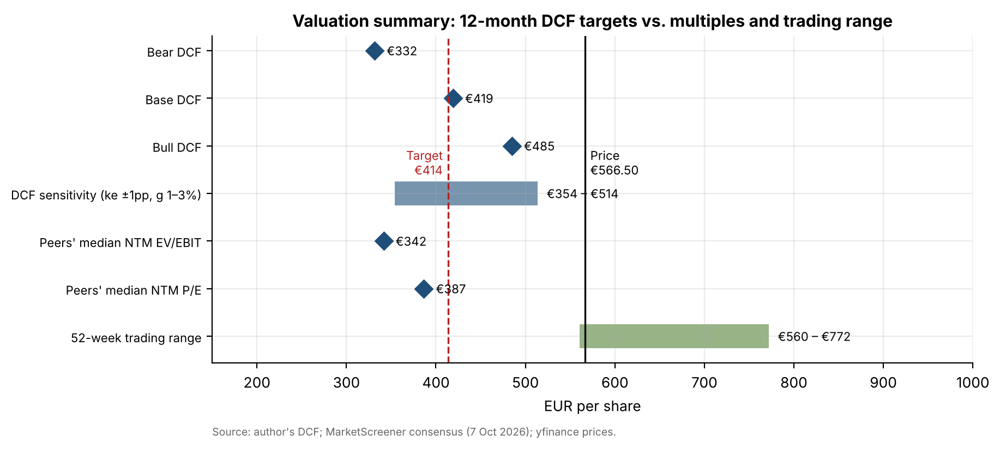
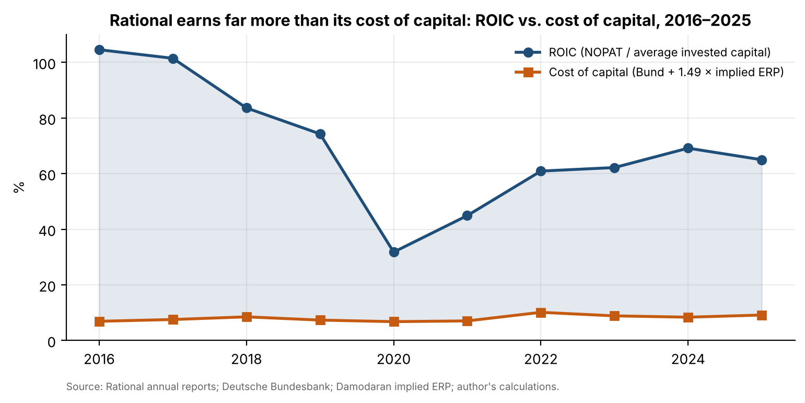
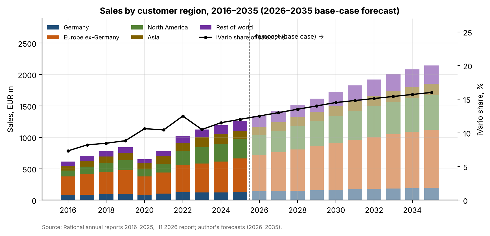

# 01 · Equity research initiation: Rational AG

## Question
Is Rational AG (Xetra: RAA), the world leader in commercial combi-steamers, a Buy, Hold or Sell at €566.50 on 7 October 2026, and what is it worth in 12 months?

## Answer
Sell: a 10-year DCF using the brief's CAPM cost of equity (9.79%) gives a probability-weighted 12-month target of €414, 27% below the share price.

## Data
| Item | Source | File |
|---|---|---|
| Income statement, balance sheet, cash flow 2016–2025 | Rational annual reports 2016–2025 (PDF, rational-online.com; not redistributed) | `data/extract_raw.csv` |
| Sales by customer region and by product group (iCombi, iVario) 2016–2025 | Same, regional breakdown and note 1 | `data/extract_regions.csv`, `data/extract_product_groups.csv` |
| H1 2026 sales, EBIT, balance sheet and guidance | H1 2026 half-year report | `data/h1_2026.csv` |
| 10-year Bund yield, daily (3.55% on 7 Oct 2026) | Deutsche Bundesbank (ECB AAA 10y as a cross-check) | `data/market/bund10y_bundesbank_daily.csv` |
| Implied equity risk premium (4.20%, Oct 2026) | Damodaran, ERPbymonth.xlsx | `data/market/damodaran_ERPbymonth.xlsx` |
| Prices: RAA.DE, STOXX Europe 600, MIDD, EPRO-B.ST, 6465.T | yfinance | `data/market/prices_*.csv` |
| Consensus EBIT, EPS, net debt FY2026–27 | MarketScreener, 7 Oct 2026 | `data/consensus/consensus_2026-10-07.csv` |

## Method
- **Excel workbook** [`model/rational_model.xlsx`](model/rational_model.xlsx). Every forecast and valuation cell is a formula. Tabs:
  - History (standardised statements for 10 years);
  - Revenue build (product group × region, 2026–2035, three scenarios);
  - DCF (free cash flow to firm, terminal growth 2%);
  - Scenarios (25/50/25);
  - Sensitivity (cost of equity ±1pp × g 1–3%);
  - Comps (NTM EV/EBIT and P/E);
  - ROIC vs cost of capital.
- **Formula check:** `src/check_workbook.py` recalculates the workbook in LibreOffice and checks it against the Python model to the cent.
- **Cost of equity:**
  - Inputs: Bund 3.55% + Blume beta 1.486 × ERP 4.20% = 9.79%.
  - Beta: 0.67 × the raw 1.726 + 0.33, estimated from 60 monthly returns against the STOXX Europe 600.
  - Net cash, so WACC = cost of equity.
- **Valuation steps:**
  - Value the H2 2026–2035 FCFF and the terminal value at the publication date.
  - Add net cash at 30 June 2026 (€425m).
  - Roll forward 12 months at the cost of equity, less the FY2026 dividend.
  - Rating rule: Buy at ≥ +15%, Sell at ≤ −10%.
- **Forecast assumptions** (regional growth, margins, iVario share, capex, working capital) are the analyst's judgements and are listed in the report's Appendix A with the historical evidence for each. Rational does not disclose sales by product within each region, so the model applies the group iVario share to every region. This is labelled as an assumption.

| | Bear (25%) | Base (50%) | Bull (25%) |
|---|---|---|---|
| Sales CAGR 2025–2035 | 3.5% | 5.5% | 6.7% |
| EBIT margin 2028+ | 24.0% | 26.5% | 28.0% |
| 12-month target | €332 | €419 | €485 |
| **Weighted target** | | **€414 (−27%) → Sell** | |

## Results






- **Premium to peers:** at 22.4× NTM P/E and 16.3× EV/EBIT, Rational trades 47% and 74% above the median of Middleby, Electrolux Professional and Hoshizaki. ROIC of 32–105% against a 7–10% cost of capital (2016–2025) justifies a premium, but not one this large on our numbers.
- **What the price implies:** a 7.2% discount rate (beta ≈ 0.88). At 9.79% it would need either about 15% sales growth a year to 2030 or a 38% EBIT margin (the ten-year high is 27.2%).
- **Robustness:** 24 of the 25 sensitivity cells imply Sell. The one exception is a 8.8% cost of equity with 3% terminal growth (€514, −9%).

Deliverables:
- the 12-page initiation report, [`report/rational_initiation.pdf`](report/rational_initiation.pdf);
- the two-minute pitch, [`report/pitch_script.md`](report/pitch_script.md);
- the model, [`model/rational_model.xlsx`](model/rational_model.xlsx).

## Limitations
- **The rating depends on beta.** Over this five-year window the raw beta is 1.73, with a standard error of 0.19. The company reports a one-year MDAX beta of 0.74. A beta near 0.9 would make the shares fairly valued.
- **Consensus is a snapshot.** It comes from one free source (MarketScreener) on one day. NTM multiples blend FY2026 and FY2027 by time.
- **Peers are not pure plays.** None of the three is a pure combi-steamer company. Hoshizaki's price is the 6 October close, the latest in yfinance.
- **The product × region split is an assumption**, as is everything after H1 2026.
- **Valuation simplifications:**
  - EPS is not forecast; the DCF values EBIT-based cash flows plus net cash.
  - The FY2026 dividend is a 70% payout of model NOPAT per share.

## How to run
```bash
pip install -r ../requirements.txt          # plus LibreOffice for the workbook check
# put the annual-report PDFs (AR_2016.pdf … AR_2025.pdf, AR_H1_2026.pdf) in data/source/ to rebuild the extracts
python src/build_extracts.py                # optional: re-extract statements from the PDFs
python src/inputs.py                        # market inputs (cached in data/market/)
cd notebooks && jupyter nbconvert --to notebook --execute --inplace valuation.ipynb && cd ..
python src/build_workbook.py && python src/check_workbook.py
python report/build_report.py
```
