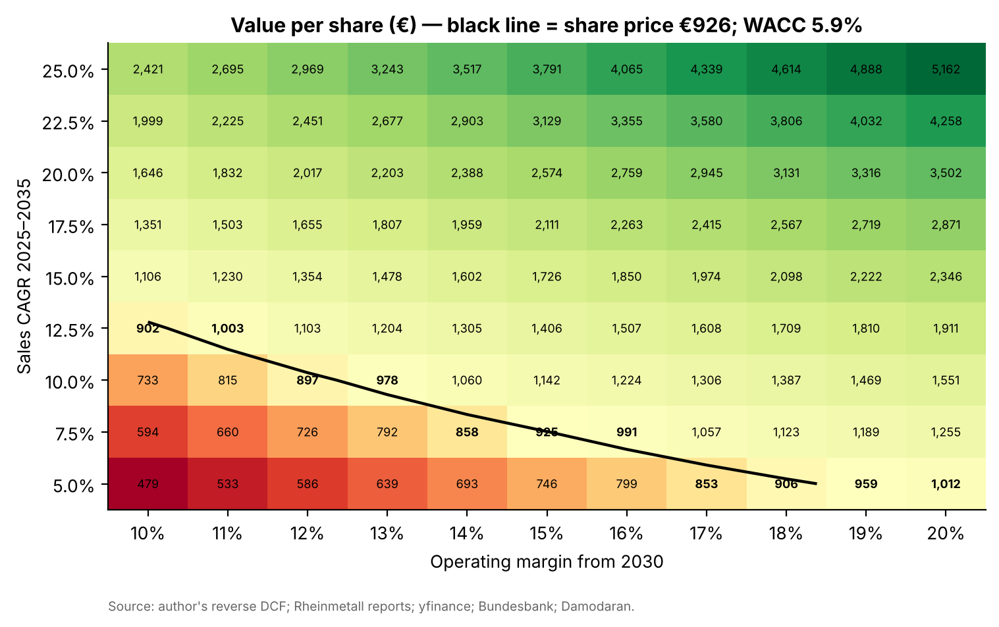
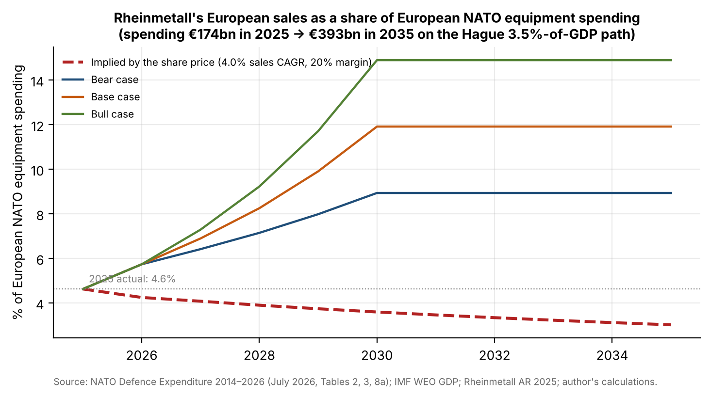
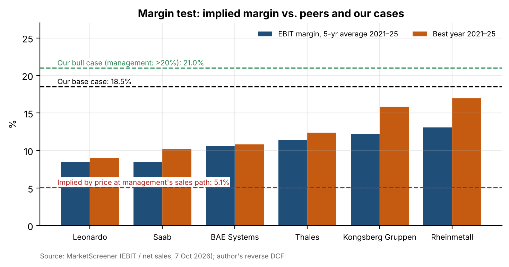

# 02 · Reverse DCF: is Rheinmetall priced for perfection?

## Question
What sales growth and margin does Rheinmetall's (Xetra: RHM) share price of €926 on 7 October 2026 assume, and are those assumptions credible against European defence budgets, the order backlog and peers' margins?

## Answer
No, it is priced for very little: at a 5.9% WACC the price implies only 4.0% a year of sales growth to 2035 at management's 20% margin (€14.7bn of 2035 sales, 3.0% of European NATO equipment spending), below our bear case on all three tests → Buy.

## Data
| Item | Source | File |
|---|---|---|
| Key figures 2019–2025 (continuing operations), H1 2026 | Rheinmetall annual report 2025 (multi-year table), H1 2026 report | `data/history.csv` (`src/extract.py`) |
| 2030 targets (~€50bn sales, >20% margin, >50% cash conversion), 2026 guidance | CMD 2025 presentation; September 2026 investor presentation | cited in `src/model.py` |
| Defence spending 2025e by country, share of GDP, equipment share | NATO, *Defence Expenditure of NATO Countries (2014–2026)*, July 2026, Tables 2, 3, 8a (scanned PDF, read by OCR) | `data/nato_ocr/` (`src/nato.py`) |
| Nominal GDP projections to 2031 | IMF World Economic Outlook (DataMapper API) | `data/market/imf_weo_NGDPD_2026-10-07.json` |
| Cost of debt: 3.375% 2031 bond (XS3344481935), price 96.60 | Börse Frankfurt; prospectus for terms | `data/market/rheinmetall_bond_quote_2026-10-07.csv` |
| Prices: RHM.DE, STOXX Europe 600, peers; EUR/USD | yfinance | `data/market/prices_*.csv` |
| Bund yield, implied ERP | Deutsche Bundesbank; Damodaran | `data/market/` |
| Peers' EBIT and sales 2021–2028 (BAE, Thales, Leonardo, Saab, Kongsberg) | MarketScreener, 7 Oct 2026 | `data/consensus/peers_2026-10-07.csv` |

## Method
- **WACC 5.86%:**
  - Cost of equity 6.07% = Bund 3.55% + Blume beta 0.60 × ERP 4.20%. The beta comes from 60 monthly returns against the STOXX Europe 600 (raw 0.40, R² 0.01).
  - Cost of debt 4.19%: the bond's yield to maturity, the same in Python and Excel `YIELD`.
  - Weights: 93% equity, 7% debt and pensions.
- **Reverse DCF** (Excel with live formulas, `model/rheinmetall_reverse_dcf.xlsx`):
  - Free cash flow = operating result × (1 − 25.3% tax) − Δsales / 5.68. The ratio 5.68 is calibrated so that management's plan meets its own 50% cash-conversion target.
  - Margin moves linearly from 18.5% (2025) to its 2030 level. Terminal growth is 2%.
  - The bridge from enterprise value to equity value uses the 30 June 2026 balance sheet.
  - Goal Seek solves (a) the 2025–2035 CAGR at a 20% margin and (b) the margin on management's sales path.
  - A grid covers CAGR 5–25% × margin 10–20%.
- **Budget test:** European NATO members' equipment spending to 2035 on a straight line to 3.5% of GDP, with IMF GDP growth.
  - It rises from €174bn to €393bn.
  - Rheinmetall's European sales (81% of the total) are compared with it, against 4.6% today.
- **Backlog test:** implied 2026–2030 sales against the €80.5bn backlog.
- **Margin test:** implied margin against the peers' 5-year average and best year.
- **Cases** (start at the 2026 guidance midpoint, then grow with budgets after 2030):

  | | 2030 sales | Margin | Value per share |
  |---|---|---|---|
  | Bear | €30bn | 15% | €1,948 |
  | Base | €40bn | 18.5% | €3,220 |
  | Bull | €50bn | 21% | €4,577 |

- **Checks:**
  - `src/check_workbook.py` recalculates the workbook in LibreOffice: Goal Seek differences are 0 and the cases, grid and WACC match Python.
  - The OCR'd NATO columns sum to NATO's own totals within €2m. % of GDP matches spending ÷ IMF GDP within 0.02pp, except Luxembourg and the Netherlands.

## Results






| Test | Implied by price | Bear | Base | Bull |
|---|---|---|---|---|
| Share of European equipment spending, 2035 | 3.0% | 8.9% | 11.9% | 14.9% |
| Cumulative sales 2026–2030 (backlog €80.5bn) | €56bn | €106bn | €126bn | €146bn |
| Operating margin from 2030 | 5.1% | 15% | 18.5% | 21% |

- **Discount rate:** the price equals the bear case at a 9.3% WACC and the base case at 12.9%. Even at 12% WACC the implied 2035 sales (€53.7bn) are below the base case.
- **Margin context:** Rheinmetall's 2025 margin (18.5%) is already above every peer's best year 2021–2025 (Kongsberg 15.9%).

Full memo (5 pages): [`report/rheinmetall_ic_memo.pdf`](report/rheinmetall_ic_memo.pdf).

## Limitations
- **The WACC is a floor, not an estimate.** The beta is statistically meaningless (standard error 0.53), so the memo shows the result across WACCs of 6–12%.
- **The NATO 2026 report is an image-only PDF**, read by OCR. Columns are validated against NATO's totals, but individual equipment shares cannot be totalled and are only range-checked.
- **Simple budget path:**
  - Equipment shares are held at 2025e.
  - Members already above 3.5% are held flat.
  - GDP after 2031 is extrapolated at IMF 2026–2031 growth.
  - "Other Europe" sales include Ukraine, which is not a NATO member.
- **Reinvestment uses one calibrated ratio.** Rheinmetall's growth has been financed by customer advances; H1 2026 working capital shows this can reverse.
- **Peer data is limited:** margins come from one source (MarketScreener) and only five years. "Best year" means best of 2021–2025, not best ever.

## How to run
```bash
pip install -r ../requirements.txt      # plus tesseract-ocr and LibreOffice
# put the Rheinmetall reports, CMD deck, bond prospectus and NATO PDFs in data/source/ (see src/*.py docstrings)
python src/extract.py && python src/inputs.py && python src/nato.py && python src/peers.py
cd notebooks && jupyter nbconvert --to notebook --execute --inplace reverse_dcf.ipynb && cd ..
python src/build_workbook.py && python src/check_workbook.py
python report/build_memo.py
```
