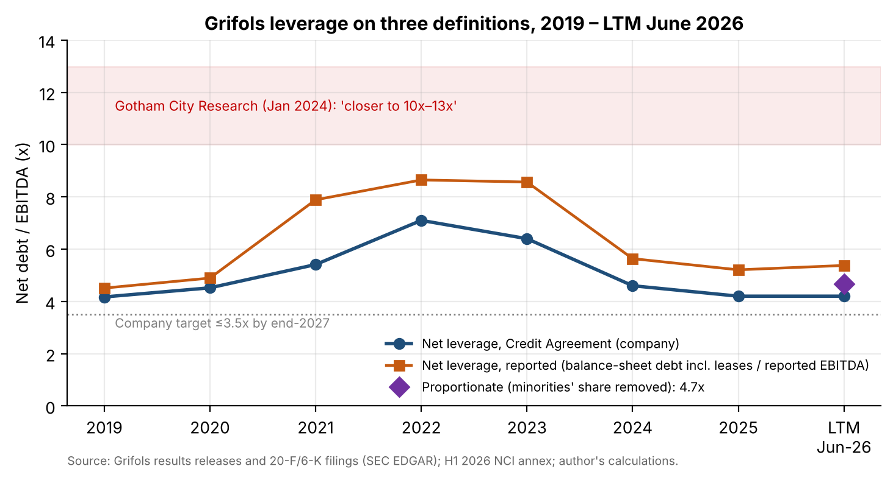
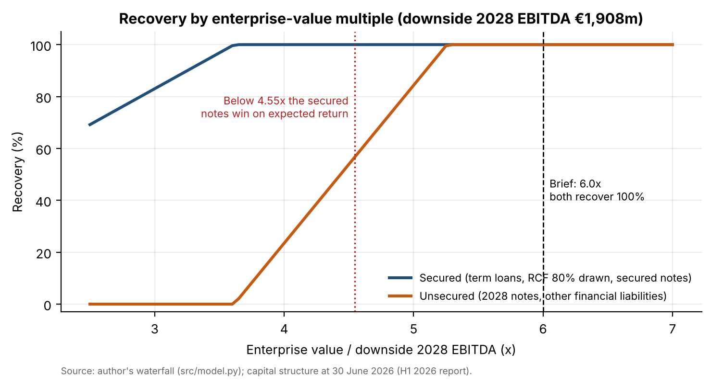
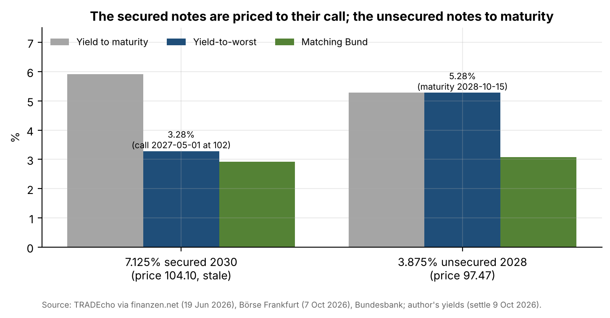

# 03 · High-yield credit memo: Grifols secured vs. unsecured

## Question
Which Grifols bond offers better risk-adjusted value on 7 October 2026: the €1.3bn 7.125% senior secured notes due May 2030 or the €1.4bn 3.875% senior unsecured notes due October 2028?

## Answer
The unsecured 2028s: their expected return is 200bp higher (5.28% vs 3.28%) because both bonds recover 100% in the brief's 6.0x downside waterfall, and the secured notes trade above their call price, so their yield-to-worst runs only to the May 2027 call at 102 → Overweight the 3.875% 2028s, Underweight the 7.125% 2030s.

## Data
| Item | Source | File |
|---|---|---|
| IFRS line items 2019–2024 | SEC XBRL company facts (20-F) | `data/source/grifols_companyfacts.json` (downloaded, not committed) |
| FY2025 statements, H1 2026 report, credit-agreement EBITDA / net debt / leverage 2019–LTM Jun-26, NCI annex | Grifols 6-K results releases and presentations (SEC EDGAR) | `data/credit_history.csv`, `data/credit_history_sources.csv` (`src/history.py`) |
| Indentures: 7.125% 2030 secured notes (19 Dec 2024), 3.875% / 4.75% 2028 notes (5 Oct 2021) | Exhibits 2.16 to the 2024 20-F and 2.9 to the 2021 20-F | `data/source/` (downloaded) |
| Credit agreement terms (April 2026: TLB 2033, RCF 2032, springing maturity) | 20-F 2025, Item 5 | `data/source/grfs-20251231x20f.htm` |
| Ratings (S&P BB-, Fitch BB-, Moody's B1) | grifols.com fixed-income page, 7 Oct 2026 | `data/source/grifols_fixed_income_ratings_2026-10-07.html` |
| Bond prices: 3.875% 2028 at 97.47 (Börse Frankfurt, 7 Oct 2026); 7.125% 2030 at 104.10 and 7.5% 2030 at 104.25 (TRADEcho via finanzen.net, **stale**: 19 Jun / 19 May 2026) | Börse Frankfurt API; finanzen.net | `data/market/bond_quotes.csv` and snapshots |
| Bund yields, residual maturity 1–4 years (Svensson) | Deutsche Bundesbank | `data/market/bund_svensson_R0*XX.csv` |
| ICE BofA Euro High Yield OAS, SOFR, EUR/USD | FRED | `data/market/fred_*.csv` |
| 3-month Euribor | ECB data portal | `data/market/ecb_euribor3m.csv` |
| Default rates: BB- 3-year cumulative 4.62% (1981–2024) | S&P *2024 Annual Global Corporate Default and Rating Transition Study* | cited in `src/model.py` |

## Method
- **Capital structure at 30 June 2026** with every instrument's amount, coupon, maturity, security and price. Yield-to-worst = lowest of the yield to maturity and the yield to each call date (Excel `YIELD`, annual-equivalent; our 5.28% for the 2028s matches Börse Frankfurt's 5.28%).
- **Credit metrics 2019–LTM June 2026:** reported vs credit-agreement leverage, secured leverage, EBITDA / cash interest, FCF / debt, liquidity.
  - Bridge from reported EBITDA (€1,645m) to covenant EBITDA (€1,863m). The largest add-back is €169m of run-rate savings.
  - **Gotham (Jan 2024):** we use Grifols' NCI annex to remove the minorities' share of EBITDA and net debt, which gives **4.7x proportionate leverage** (vs 4.2x headline and Gotham's 10–13x).
- **Covenants:** debt incurrence, restricted payments, asset sales and change of control for both indentures, in a one-page table.
- **Projections 2026–2028:**
  - Base: revenue flat in 2026, then +5% a year; margin 25.0 / 25.5 / 26.0%. 2026 FCF of €558m sits inside the €500–575m guidance.
  - Downside: margin −300bp. This equals a 10% plasma-cost rise if plasma is 48% of cost of sales, which Grifols does not disclose.
  - Output: leverage and liquidity at the October 2028 maturity.
- **Recovery waterfall** (following the brief): default in 2028; EV = downside 2028 EBITDA × 6.0x; 5% administrative claims; secured claims (term loans, RCF 80% drawn, secured notes) pari passu; then unsecured.
- **Relative value:** spread over the matching-maturity Bund, spread per turn of leverage, and expected return = YTW − PD × (1 − recovery), with PD = S&P BB- 3-year cumulative rate. Recommendation rule: Overweight the higher expected return; Neutral if the gap is under 50bp.
- **Checks:** `src/check_workbook.py` recalculates the Excel model in LibreOffice and matches every yield, projection, recovery and the recommendation to the Python model (all pass).

## Results






| | 7.125% secured 2030 | 3.875% unsecured 2028 |
|---|---|---|
| Price | 104.10 (stale) | 97.47 |
| Yield-to-worst (worst date) | 3.28% (call May 2027 at 102) | 5.28% (maturity) |
| Spread over matching Bund | 36bp | 221bp |
| Spread per turn of leverage | 14bp (2.65x secured) | 53bp (4.19x total) |
| Recovery (6.0x waterfall) | 100% | 100% |
| Expected return | 3.28% | 5.28% |

- **Refinancing:** leverage at the October 2028 maturity is 2.9x in the base case and 3.5x in the downside. Liquidity covers the €2.0bn of notes due 1.8x in the base case and 1.5x in the downside.
- **What flips the call:**
  - a secured price below 102.83 (neutral at 103.26);
  - or a recovery multiple below 4.55x (neutral at 4.72x). Below 5.26x the unsecured notes stop recovering in full.

Full memo (8 pages): [`report/grifols_credit_memo.pdf`](report/grifols_credit_memo.pdf). Excel model: [`model/grifols_credit_model.xlsx`](model/grifols_credit_model.xlsx).

## Limitations
- **The secured price is stale.** The 2030 notes do not trade on a German exchange, and the last free print is TRADEcho on 19 June 2026. The brief's source (Börse Frankfurt) has no page for them.
- **Plasma cost per litre is not disclosed** as a share of cost of sales, so the downside models one 300bp shock and states the plasma share that makes the two descriptions equal.
- **The waterfall follows the brief and is generous at 6.0x.** It ignores structural subordination, collateral gaps and the GIC liability's exact ranking.
- **Default rates come from S&P's 2024 study**, because the 2025 study is not freely available.
- **Flat assumptions:** capex, taxes, working capital, dividends and base rates are held at today's levels.

## How to run
```bash
pip install -r ../requirements.txt       # plus LibreOffice for the workbook check
python src/download.py                    # SEC filings, company facts, FRED/ECB/Bundesbank series (S&P PDF by hand)
python src/history.py                     # credit metrics 2019 – LTM June 2026
cd notebooks && jupyter nbconvert --to notebook --execute --inplace credit.ipynb && cd ..
python src/build_workbook.py && python src/check_workbook.py
python report/build_memo.py
```
