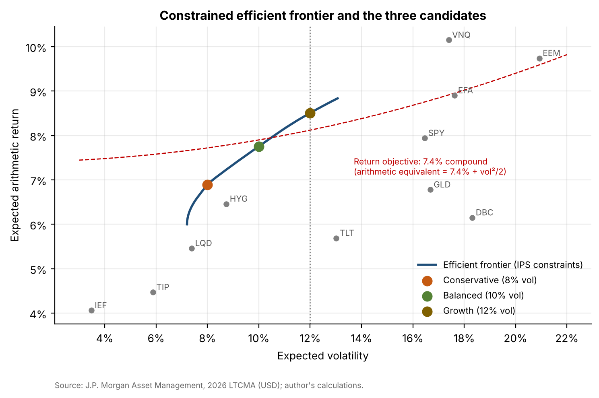
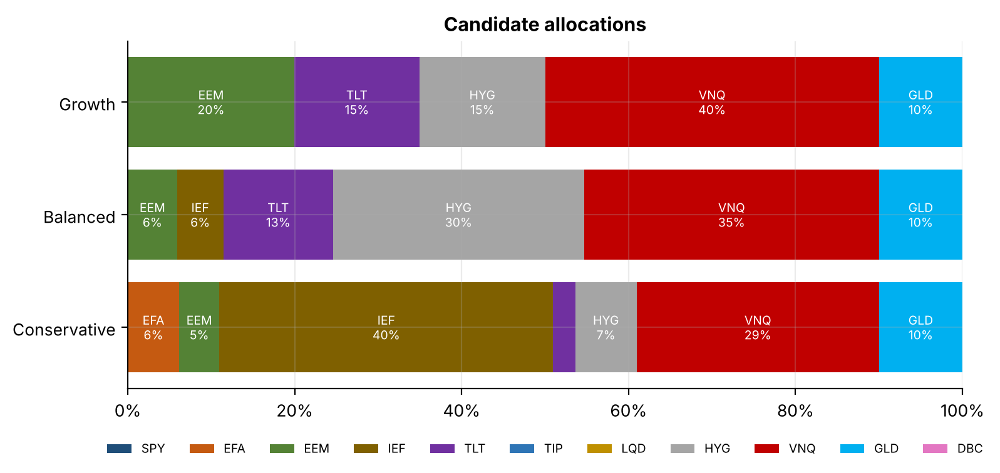
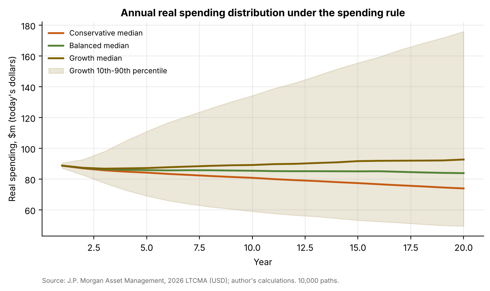

# 04 · Strategic asset allocation and IPS: Northbridge University Endowment

## Question
Which strategic allocation of the 11 shared ETFs gives a $2bn perpetual endowment (fictional client) that spends 4.5% a year the best chance of preserving its real value, while keeping expected volatility at or below 12% and the probability of a one-year loss worse than −20% at or below 5%?

## Answer
The Growth portfolio (EEM 19%, TLT 15%, HYG 16%, VNQ 40%, GLD 10%) has a 55% probability of preserving real value over 20 years, against 47% for Balanced and 32% for Conservative. It is the only candidate whose expected compound return (7.8%) beats the 7.4% hurdle, but it is a concentrated bet on REITs.

## Data
| Item | Source | File |
|---|---|---|
| Expected returns, volatilities, correlations (incl. inflation and cash), USD | J.P. Morgan Asset Management, *2026 Long-Term Capital Market Assumptions*, 30th edition, U.S. dollar matrix (as of 30 Sep 2025; latest edition available) | `data/ltcma2026_usd_assumptions.csv`, `data/ltcma2026_usd_correlations.csv` |
| Daily adjusted closes, 11 ETFs, Apr 2007 – Sep 2026 (historical cross-check) | Yahoo Finance via `yfinance` | `data/etf_prices_daily.csv` |
| 3-month T-bill | FRED `TB3MS` | `data/fred_TB3MS.csv` |

ETF mapping: SPY→U.S. Large Cap, EFA→EAFE Equity, EEM→Emerging Markets Equity, IEF→U.S. Intermediate Treasuries, TLT→U.S. Long Treasuries, TIP→TIPS, LQD→U.S. Inv Grade Corporate Bonds, HYG→U.S. High Yield Bonds, VNQ→U.S. REITs, GLD→Gold, DBC→Commodities. `src/ltcma.py` downloads the public PDF and extracts the figures; the PDF itself is not redistributed.

## Method
1. **Efficient frontier** with PyPortfolioOpt (arithmetic expected returns, LTCMA covariance) under the IPS constraints: max 40% per ETF; equities (SPY, EFA, EEM, VNQ) 40–70%; IEF + TLT + TIP ≥ 15%; GLD + DBC ≤ 10%.
2. **Three candidates** on the frontier at 8%, 10% and 12% expected volatility.
3. **Monte Carlo**: 10,000 paths × 20 years in quarterly steps. Asset returns and inflation are joint lognormal, matched to the LTCMA means, volatilities and correlations. Each quarter: rebalance to target, deduct 0.10% costs, pay 4.5%/4 of the trailing 12-quarter average value. Outputs: P(real value ≥ $2.0bn after 20 years), P(drawdown worse than −30%), median real spending path, P(one-year loss worse than −20%).
4. **Selection rule**: the highest P(preserve real value) among candidates meeting the risk limit. All three meet it, and Growth is chosen. Its weights are rounded to whole percentages within every limit (EEM 20% would push volatility to 12.006%, so EEM is 19% and HYG 16%).
5. **Rebalancing**: ±20% relative bands checked at month-end, tested on 2007–2026 ETF returns.
6. Extra checks: a REIT-assumption sensitivity, and LTCMA vs. 2007–2026 history.

| | Conservative | Balanced | **Growth** | Growth, rounded policy |
|---|---|---|---|---|
| Expected return (arith. / compound) | 6.9% / 6.6% | 7.8% / 7.3% | 8.5% / 7.8% | 8.5% / 7.8% |
| Expected volatility | 8.0% | 10.0% | 12.0% | 11.9% |
| P(real value preserved, 20y) | 31.6% | 47.2% | **55.5%** | 55.2% |
| P(drawdown worse than −30%) | 21.9% | 34.4% | 48.2% | 47.5% |
| P(1-year loss worse than −20%) | 0.00% | 0.08% | 0.34% | 0.32% |
| Median real spending, year 20 | $74m | $84m | $93m | $92m |

## Results






- The optimizer holds **0% US large caps and 40% REITs**, because J.P. Morgan's REIT assumption (8.8% compound) is the highest of the 11. The answer rests on that one input: with REITs 2 points lower, the REIT weight falls from 40% to 9%.
- **History is harsher than the model.** On actual 2007–2026 ETF returns, the policy had 14.0% volatility, a −37.7% worst 12 months (to Feb 2009) and −21.9% in 2022. The model treats a −20% year as a 0.3% event.
- **Rebalancing:** three targets sit exactly on IPS limits. Treating the limits as triggers for drifted weights would have meant 217 rebalances in 233 months, against 23 with the ±20% bands. So the IPS applies the limits to targets.

**Deliverables:** [`report/ips.pdf`](report/ips.pdf) (Investment Policy Statement: purpose; governance and roles; objectives; constraints; strategic allocation with ranges; policy benchmark; rebalancing; monitoring and reporting; annual review; appendix with the analysis), [`report/board_presentation.pdf`](report/board_presentation.pdf) (10 slides) and the notebook `notebooks/saa.ipynb`. The final policy weights used by later projects are in `data/final_policy_weights.csv`.

## Limitations
- Mean-variance optimization amplifies errors in expected returns, so the allocation is concentrated and unstable.
- Lognormal returns understate crash risk; the historical cross-check shows two −20% years in 19 years.
- The LTCMA are 10–15 year assumptions as of September 2025; the Monte Carlo treats them as constant for 20 years.
- The Monte Carlo rebalances quarterly to target, whereas the policy uses bands. Taxes and spending timing within the quarter are ignored.

## How to run
```bash
pip install -r ../requirements.txt
cd notebooks && jupyter nbconvert --to notebook --execute --inplace saa.ipynb
cd .. && python report/build_ips.py && python report/build_deck.py
```
