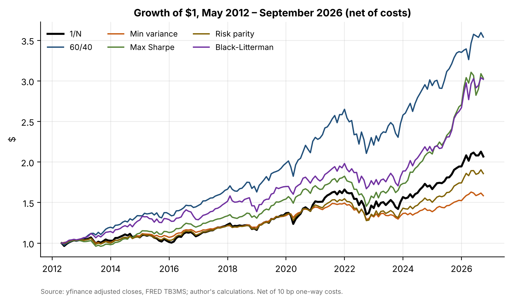
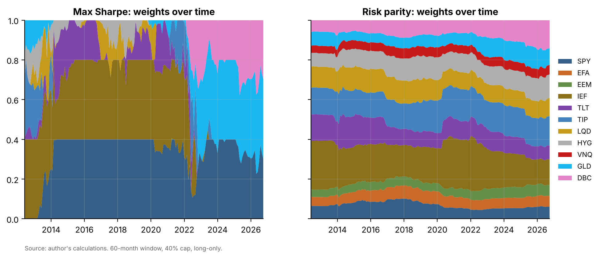
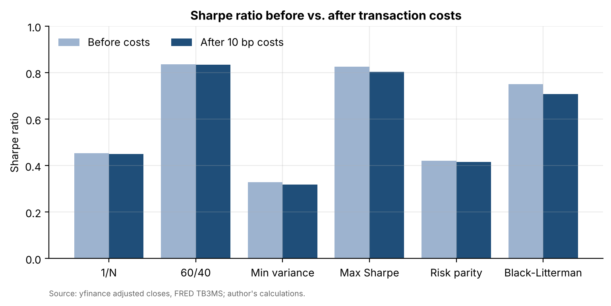

# 05 · Does optimization beat 1/N? A portfolio construction backtest

## Question
Does any of five standard portfolio construction methods beat a simple equal-weight (1/N) portfolio of 11 multi-asset ETFs after transaction costs, as DeMiguel, Garlappi and Uppal (2009) ask?

## Answer
Only partly: the naive maximum-Sharpe optimizer beat 1/N after 10 bp costs (net Sharpe 0.80 vs. 0.45, bootstrap p = 0.034), but the edge is not significant with a 36-month window (p = 0.102), at 25 bp costs (p = 0.054) or within either subperiod. A plain 60/40 portfolio had the highest net Sharpe ratio of all six (0.83, p = 0.012 vs. 1/N).

## Data
| Item | Source | File |
|---|---|---|
| Daily adjusted closes, 11 ETFs (SPY, EFA, EEM, IEF, TLT, TIP, LQD, HYG, VNQ, GLD, DBC), Apr 2007 – 30 Sep 2026 | Yahoo Finance via `yfinance` | `data/etf_prices_daily.csv` |
| Monthly total returns, May 2007 – Sep 2026 (233 months) | computed from the above | `data/etf_monthly_returns.csv` |
| 3-month T-bill rate | FRED `TB3MS` | `data/fred_TB3MS.csv` |

All results tables, net return series and weights are saved in `data/` too.

## Method
- Rolling 60-month estimation window; out-of-sample May 2012 – Sep 2026 (173 months). Weights for month *t* use returns up to *t−1* only.
- Monthly rebalancing, long-only, max 40% per ETF, 10 bp one-way costs on turnover (target vs. drifted weights).
- Six strategies: **1/N**; **60/40** (SPY/IEF); **minimum variance** (Ledoit-Wolf shrunk covariance); **maximum Sharpe** (sample means and covariance); **risk parity** (equal risk contribution); **Black-Litterman** (given prior weights, δ = 2.5, τ = 0.05, monthly 12-1 momentum view: top 3 beat bottom 3 by 3%/yr at 50% Idzorek confidence).
- Measures: annualized return, volatility, Sharpe, Sortino (vs. TB3MS), max drawdown, Calmar, monthly turnover, effective number of holdings.
- Test: 5,000-draw stationary bootstrap (Politis-Romano; Politis-White block length) of each strategy's Sharpe difference vs. 1/N.
- Robustness: 36-month window; 25 bp costs; subperiods before and after 2024.

| Strategy | Ann. return | Vol. | Sharpe (net) | Max DD | Turnover /mo | p vs 1/N |
|---|---|---|---|---|---|---|
| 1/N | 5.2% | 8.2% | 0.45 | −18.5% | 2.1% | – |
| 60/40 | 9.2% | 9.0% | **0.83** | −20.5% | 1.6% | 0.012 |
| Min variance | 3.2% | 5.0% | 0.32 | −13.4% | 4.5% | 0.330 |
| Max Sharpe | 8.0% | 7.9% | 0.80 | −20.3% | 13.9% | 0.034 |
| Risk parity | 4.4% | 6.8% | 0.42 | −17.4% | 2.6% | 0.641 |
| Black-Litterman | 8.0% | 9.0% | 0.71 | −15.7% | 33.0% | 0.106 |

## Results






- 60/40 wins on Sharpe ratio, and it is the only result that holds up in every robustness check. That reflects the period (SPY returned 14.5% a year; IEF, TLT, TIP and DBC returned −0.1% to 2.1%) more than any construction method.
- Unlike in DeMiguel et al., the naive maximum-Sharpe optimizer beats 1/N. The 40% cap and long-only constraint shrink its extreme bets, and it rode persistent trends (SPY and IEF in the 2010s, gold after 2022). Before 2024 its edge over 1/N is not significant (p = 0.23).
- Risk-based methods (minimum variance, risk parity) do not beat 1/N. Black-Litterman's 33% monthly turnover eats a large part of its edge.

Full write-up: [`report/report.pdf`](report/report.pdf).

## Limitations
- One 14-year path that favoured US large caps; results depend on the period.
- The ETF universe is chosen with hindsight and all 11 funds survived.
- Flat 10 bp costs; no taxes, market impact or wider spreads during stress.
- Yahoo Finance adjusted prices assume dividends are reinvested on the ex-date.

## How to run
```bash
pip install -r ../requirements.txt
cd notebooks
jupyter nbconvert --to notebook --execute --inplace backtest.ipynb   # or open it in Jupyter
cd .. && python report/build_report.py                                # rebuilds report/report.pdf
```
Cached inputs in `data/` are reused; delete `data/etf_prices_daily.csv` and `data/fred_TB3MS.csv` to re-download. The notebook source is also kept as `notebooks/backtest.py` (jupytext percent format). The backtest engine is in `src/backtest.py`.
