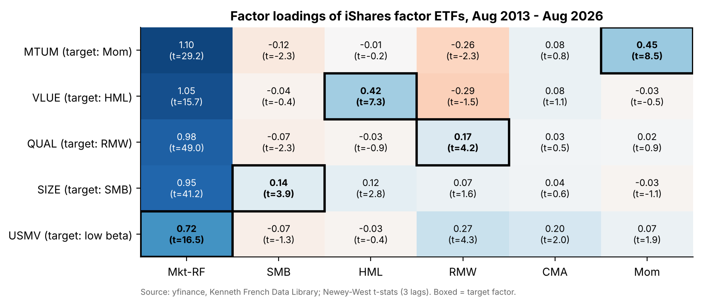
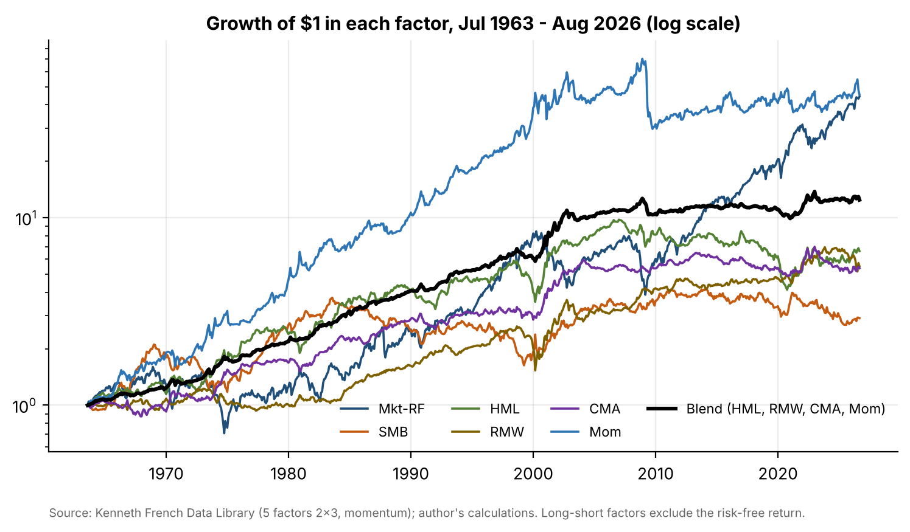
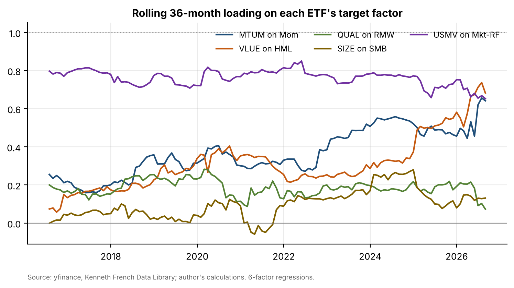

# 07 · Factor premia since 1963, and do factor ETFs deliver them?

## Question
How large and reliable have the US equity factor premia been since 1963, and do five popular iShares factor ETFs actually carry the factor exposure their names promise?

## Answer
Market and momentum earned about 7.2% a year each (t = 3.7 and 3.9), value, profitability and investment about 3% (all significant) and size only 2.2% (t = 1.7, not significant). All five ETFs load significantly on their target factor, but in very different doses: MTUM carries 0.45× and VLUE 0.42× a pure long-short factor, while QUAL (0.17× profitability) and SIZE (0.14× size) are mostly market exposure.

## Data
| Item | Source | File |
|---|---|---|
| Fama/French 5 Factors (2x3), monthly, Jul 1963 – Aug 2026 | Kenneth French Data Library | `data/ff5_monthly.csv` |
| Momentum Factor, monthly | Kenneth French Data Library | `data/ff_momentum_monthly.csv` |
| NBER recession indicator; CPI (all urban consumers) | FRED `USREC`, `CPIAUCSL` | `data/fred_USREC.csv`, `data/fred_CPIAUCSL.csv` |
| MTUM, QUAL, VLUE, USMV, SIZE daily adjusted closes, Jul 2013 – Sep 2026 | Yahoo Finance via `yfinance` | `data/factor_etf_prices_daily.csv` |

August 2026 is the latest month in the French library at the time of writing, so the factor analysis and the regressions end there. FRED has no CPI for October 2025 (not published during the US government shutdown), so that month is left out of the inflation split only.

## Method
**Part A (Jul 1963 – Aug 2026, 758 months).** For Mkt-RF, SMB, HML, RMW, CMA and Mom:
1. Annualized premium, volatility, Sharpe ratio, t-statistic, maximum drawdown, worst rolling 5-year return.
2. Decade-by-decade compounded returns.
3. Correlations, full sample and since 2010.
4. Average monthly premium in NBER recessions vs. expansions, and with CPI inflation above vs. below 4% (Welch t-tests).
5. Value's lost decade: HML from Jan 2007 to Dec 2020, and how much of the loss has been recovered since.
6. Equal-weight blend of HML, RMW, CMA and Mom vs. each factor alone.

**Part B (Aug 2013 – Aug 2026, 157 months).** Each ETF's monthly excess return is regressed on the five Fama-French factors plus momentum (OLS, Newey-West standard errors, 3 lags). Then: annualized alpha, loadings with t-statistics and R². I check whether the target factor (MTUM→Mom, VLUE→HML, QUAL→RMW, SIZE→SMB) is the largest style loading, and whether USMV's beta is below 1. I also run rolling 36-month loadings on the target factor, plus CAPM and 3-factor robustness regressions.

| ETF | Target | Target loading (t) | Largest style loading | Alpha /yr (t) | R² |
|---|---|---|---|---|---|
| MTUM | Mom | 0.45 (8.5) | Mom | −0.5% (−0.35) | 0.89 |
| VLUE | HML | 0.42 (7.3) | HML | 0.2% (0.11) | 0.87 |
| QUAL | RMW | 0.17 (4.2) | RMW | −0.6% (−0.80) | 0.96 |
| SIZE | SMB | 0.14 (3.9) | SMB | −1.1% (−1.15) | 0.94 |
| USMV | β < 1 | β = 0.72 (t vs 1 = −6.4) | RMW (0.27) | −0.6% (−0.36) | 0.79 |

## Results






- **Size is not significant** over 63 years; every factor, including the market, had a 10-year window with a negative average premium.
- **Value lost 55.8%** from Jan 2007 to Dec 2020 (−5.7% a year), bottoming in Sep 2020. It has since returned +53.8%, recovering 43% of the dollar loss.
- **Blending works:** an equal-weight blend of HML, RMW, CMA and Mom had a Sharpe ratio of 0.74 against 0.49 for the best single factor, and a −21.8% maximum drawdown against −27.6% for the best single factor.
- **Factor ETFs:** labels are right but doses differ. USMV has a larger profitability loading (0.27) than QUAL (0.17). No ETF has a significant alpha, and none beat the market's Sharpe ratio over 2013–2026.

Full write-up: [`report/report.pdf`](report/report.pdf).

## Limitations
- Fama-French factors are paper long-short portfolios before costs; investors cannot capture them in full.
- The ETF sample is 157 months, mostly one bull market.
- Recession (85 months) and high-inflation splits have low statistical power.
- MSCI factor index definitions differ from Fama-French definitions, so loadings measure overlap, not the provider's intent.

## How to run
```bash
pip install -r ../requirements.txt
cd notebooks && jupyter nbconvert --to notebook --execute --inplace factors.ipynb
cd .. && python report/build_report.py
```
Delete the CSVs in `data/` to re-download the latest data. The notebook source is also kept as `notebooks/factors.py` (jupytext).
