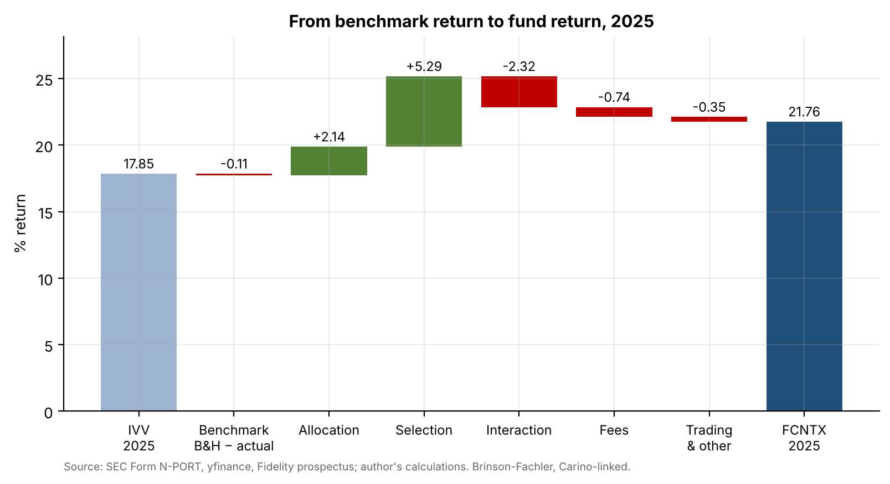
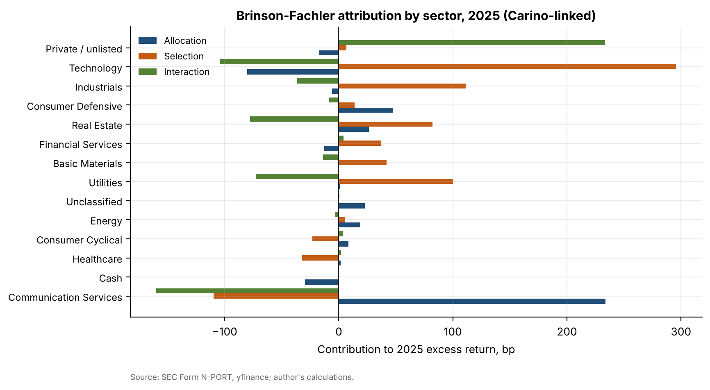
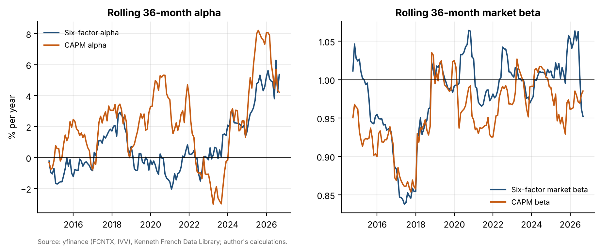

# 07 · Skill or exposure? Performance attribution of Fidelity Contrafund

## Question
Do Fidelity Contrafund's (FCNTX) results against the S&P 500 come from stock-picking skill, or from factor and sector exposure?

## Answer
Exposure: over 2011–2026 the six-factor alpha is 0.73% a year with t = 0.78, not significant. In 2025, selection was the largest Brinson effect (+529 bp of the fund's +512 bp buy-and-hold excess), led by its private SpaceX stake (+181 bp).

## Data
| Item | Source | File |
|---|---|---|
| FCNTX and IVV daily adjusted closes, Sep 2011 – Sep 2026 | Yahoo Finance via `yfinance` | `data/fund_prices_daily.csv` |
| Fama/French 5 factors (2x3) and momentum, monthly (to Aug 2026) | Kenneth French Data Library | `data/ff5_monthly.csv`, `data/ff_momentum_monthly.csv` |
| Holdings at 31 Dec 2024, 31 Mar, 30 Jun, 30 Sep, 31 Dec 2025 | SEC EDGAR Form N-PORT-P (Contrafund S000006037; IVV S000004310) | `data/nport/` |
| ISIN → ticker | OpenFIGI API, Yahoo search, manual tickers for 36 names (`data/manual_ticker_overrides.json`) | `data/security_master.csv` |
| Quarter-end total-return prices in USD for 795 of 824 securities | `yfinance` (+ FX) | `data/quarter_end_prices_usd.csv` |
| Sector of every stock | `yfinance` sector field | `data/sectors.csv` |
| Fiscal 2025 expense ratio (0.74%) | Contrafund summary prospectus, EDGAR, 27 Feb 2026 | cited in the notebook |
| 3-month T-bill | FRED `TB3MS` | `data/fred_TB3MS.csv` |

## Method
**Part A (returns-based, Oct 2011 – Sep 2026):**
- CAPM, Fama-French 3-factor and 5-factor + momentum regressions (Newey-West t-statistics).
- Rolling 36-month alpha and market beta.
- Tracking error, information ratio, up- and down-capture vs. IVV.

**Part B (holdings-based Brinson-Fachler, calendar 2025):**
- For each quarter, hold the starting N-PORT holdings of both portfolios (buy-and-hold).
- Value listed stocks with market prices. Value private holdings with the fund's own N-PORT fair values per unit. Cash earns the T-bill rate.
- Split each quarter's excess return into allocation, selection and interaction by sector, then link the four quarters with Cariño smoothing (exact by construction; asserted in the notebook).
- Reconcile the residual with the actual 2025 return (fees vs. intra-quarter trading).
- Rank the ten largest contributors and detractors.

| | Value |
|---|---|
| FCNTX / IVV annualized return, Oct 2011 – Sep 2026 | 17.03% / 15.57% |
| Tracking error / information ratio | 5.20% / 0.27 |
| Up- / down-capture | 102% / 96% |
| Alpha CAPM / FF3 / FF5+Mom (t) | 1.65% (1.11) / 1.16% (1.18) / 0.73% (0.78) |
| 2025 actual: FCNTX / IVV | 21.76% / 17.85% |
| 2025 buy-and-hold excess = allocation + selection + interaction | +512 bp = +214 + 529 − 232 |
| Residual: fees / trading and other | −74 bp / −35 bp |
| Method check: IVV buy-and-hold vs. actual | 17.73% vs. 17.85% |

## Results






- **Factor profile:** large-cap growth with momentum (SMB −0.12, HML −0.14, CMA −0.14, Mom +0.10). Adding factors shrinks the alpha from 1.65% to 0.73%.
- **2025:** selection in technology (+296 bp), industrials (+111 bp) and utilities (+100 bp); a communication-services overweight added +234 bp of allocation; private companies added +233 bp of interaction.
- **Top contributors:** SpaceX (+181 bp, private), Amphenol (+122 bp). **Top detractors:** Berkshire Hathaway (−42 bp, +6.7% active weight, returned 11%), and underweights in Micron (−41 bp) and Palantir (−37 bp). Holding 2% cash cost 37 bp.

Full write-up: [`report/report.pdf`](report/report.pdf).

## Limitations
- Buy-and-hold quarters miss intra-quarter trading, which appears only in the residual.
- Private holdings use Fidelity's fair values (estimates, updated infrequently).
- 29 securities (acquired or delisted, without Yahoo price history) are left out: at most 0.5% of the fund and 0.2% of IVV in any quarter. Weights are rescaled over the rest.
- Yahoo sectors are not GICS; the fee is applied as a uniform annual drag.

## How to run
```bash
pip install -r ../requirements.txt
cd notebooks && jupyter nbconvert --to notebook --execute --inplace attribution.ipynb && cd ..
python report/build_report.py
```
The data-collection code is in `src/`: `nport.py` (EDGAR N-PORT parser), `mapping.py` (OpenFIGI), `prices.py`, `sectors.py` and `brinson.py`. Cached inputs in `data/` make the notebook reproducible offline.
