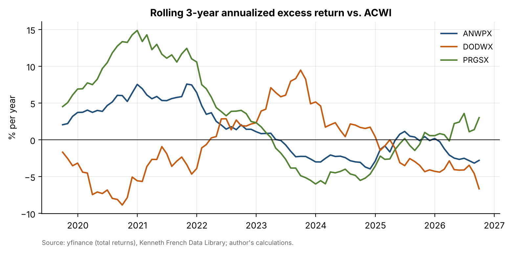
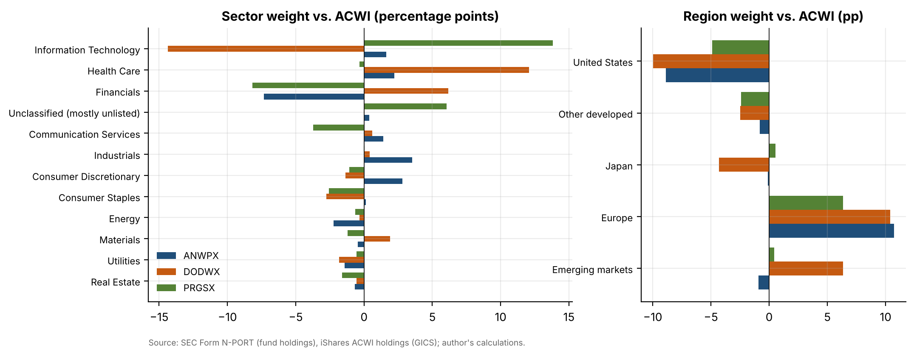
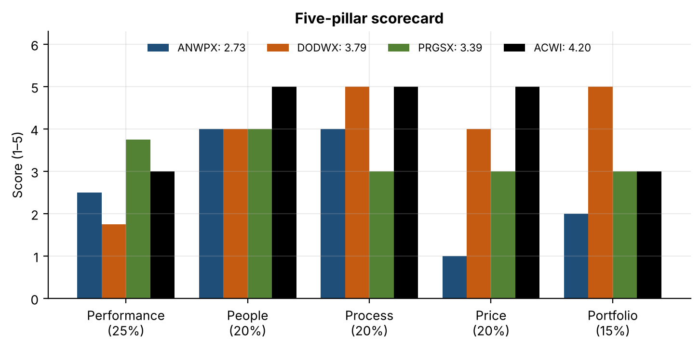

# 08 · Manager selection: three global equity funds vs. the index

## Question
Which of Capital Group New Perspective (ANWPX), Dodge & Cox Global Stock (DODWX) and T. Rowe Price Global Stock (PRGSX) should we hold, or does none of them earn its fee over the iShares MSCI ACWI ETF?

## Answer
ACWI: the highest-scoring active fund, DODWX (3.79 of 5, 85% active share), has a 10-year information ratio of −0.09 against ACWI, below the 0.2 hurdle in the decision rule.

## Data
| Item | Source | File |
|---|---|---|
| Daily adjusted closes, Sep 2016 – Sep 2026 (monthly total returns Oct 2016 – Sep 2026) | Yahoo Finance via `yfinance` | `data/fund_prices_daily.csv` |
| Fama-French Developed 5 Factors and Developed Momentum (to Aug 2026) | Kenneth French Data Library | `data/ff_developed_5f.csv`, `data/ff_developed_mom.csv` |
| Holdings: ANWPX and DODWX 30 Jun 2026, PRGSX 31 Jul 2026, ACWI 30 Apr and 31 Jul 2026 | SEC EDGAR Form N-PORT (located by series ID) | `data/nport/` |
| ACWI holdings with GICS sectors, 30 Jun and 31 Jul 2026 | ishares.com holdings file | `data/acwi_holdings_*.raw` |
| GICS sector and country of each fund holding | iShares match by ticker and country, OpenFIGI, `yfinance` fallback | `data/*_holdings_classified.csv` |
| Fees, sales loads, turnover, managers, stated strategy (latest and ~2021) | Summary prospectuses (Form 497K), EDGAR | `data/prospectus/` |

## Method
- **Performance (25%):**
  - Ten-year annualised return, and the return after the maximum sales load.
  - Excess return, tracking error and information ratio vs. ACWI.
  - Up- and down-capture, share of rolling 3-year periods beating ACWI, and maximum drawdown.
  - Six-factor alpha (Developed FF5 + momentum, Newey-West t-statistics).
- **People (20%):** named managers, average tenure and departures, comparing the latest prospectus with the one from about 2021.
- **Process (20%):** four yes/no checks per fund. Each check tests a statement in the prospectus against the factor loadings and holdings.
- **Price (20%):** expense ratio plus the sales load spread over 10 years, compared with ACWI's 0.32%.
- **Portfolio (15%):**
  - Active share vs. ACWI, matched by ISIN from N-PORT, with an issuer (LEI) robustness check.
  - Top-10 weight and unlisted (Level 3) weight.
  - GICS sector and region tilts.
- **Scoring and decision:** each pillar is scored 1–5 with banded rules written in the notebook before the results were viewed. The decision rule recommends the highest-scoring fund unless its IR is below 0.2, in which case it recommends ACWI. Four alternative pillar weightings are tested.

| | ANWPX | DODWX | PRGSX | ACWI |
|---|---|---|---|---|
| 10y ann. return (after max load) | 12.98% (12.31%) | 11.16% | 15.95% | 12.45% |
| Excess vs ACWI / IR | +0.53% / 0.18 | −1.29% / −0.09 | +3.50% / 0.53 | – |
| Six-factor alpha (t) | 0.31% (0.38) | −0.82% (−0.68) | 3.03% (1.94) | −0.24% (−0.75) |
| Active share / top-10 weight | 60% / 27% | 85% / 28% | 68% / 29% | – |
| All-in cost (expense ratio + load/10) | 1.29% | 0.62% | 0.81% | 0.32% |
| **Weighted score (of 5)** | **2.73** | **3.79** | **3.39** | **4.20** |

## Results






- **No fund has significant alpha.** PRGSX comes closest (3.03%, t = 1.94). Its loadings show growth, momentum and significantly *negative* profitability (RMW −0.43, t = −3.1), which only partly matches its "high-quality companies" process.
- **DODWX is the purest style fund.** It has a value loading of 0.41 (t = 5.8), negative momentum, and holdings 14 points underweight technology and 12 overweight health care. It passes all four process checks, but its value tilt cost it 1.3% a year against ACWI over the decade.
- **ANWPX looks like the index plus a load.** Its 60% active share and +0.53% a year excess disappear after the 5.75% Class A sales load.
- **PRGSX's risks:**
  - a single portfolio manager since 2012;
  - 172% turnover;
  - 4.9% in unlisted Level 3 positions (Databricks, Anthropic, OpenAI and others);
  - drawdown 10 points deeper than ACWI's.

  It becomes the recommendation only if performance is weighted at 50%.

Deliverables:
- the 10-page due diligence report, [`report/dd_report.pdf`](report/dd_report.pdf);
- the one-page scorecard, [`report/scorecard.pdf`](report/scorecard.pdf);
- 10 meeting questions for each manager, [`report/dd_questions.pdf`](report/dd_questions.pdf).

## Limitations
- Ten years is short: even PRGSX's IR of 0.53 is only about 1.7 standard errors from zero.
- The share classes used are ANWPX Class A (with its load) and PRGSX Investor. Cheaper classes would score better on price.
- Holdings are one N-PORT snapshot. ACWI files N-PORT only for April and July, so the June fund holdings are compared with the July and April index, which agree within one point.
- Process checks reduce each prospectus to four testable statements. Manager ownership, pay and analyst turnover are not in the data and are covered in the meeting questions instead.
- PRGSX was shortlisted as a "concentrated" fund, but its prospectus says "broadly diversified". The checks test the prospectus wording.

## How to run
```bash
pip install -r ../requirements.txt
python src/collect.py      # downloads N-PORT, iShares, prospectus and sector inputs (skips files already in data/)
cd notebooks && jupyter nbconvert --to notebook --execute --inplace selection.ipynb && cd ..
python report/build_report.py   # dd_report.pdf, scorecard.pdf, dd_questions.pdf
```
