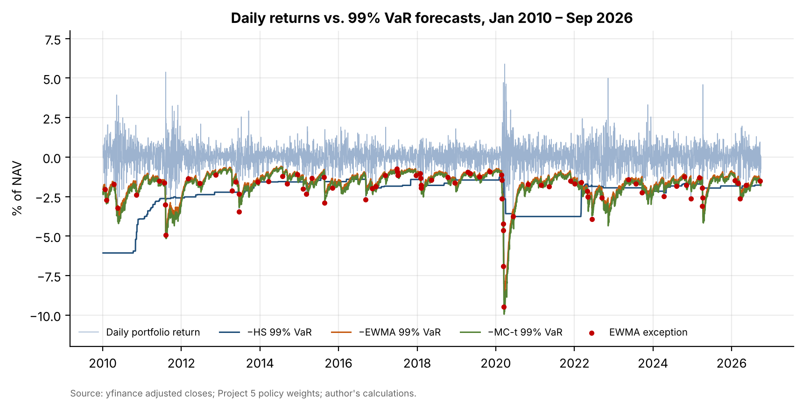
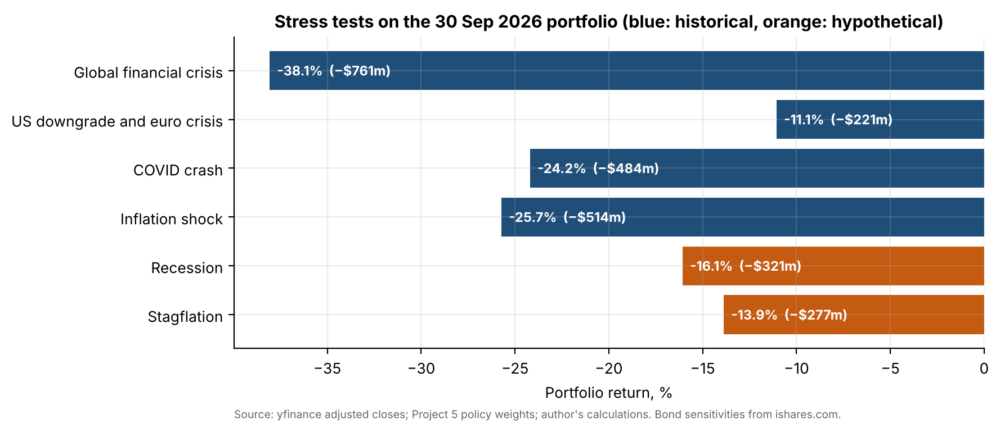
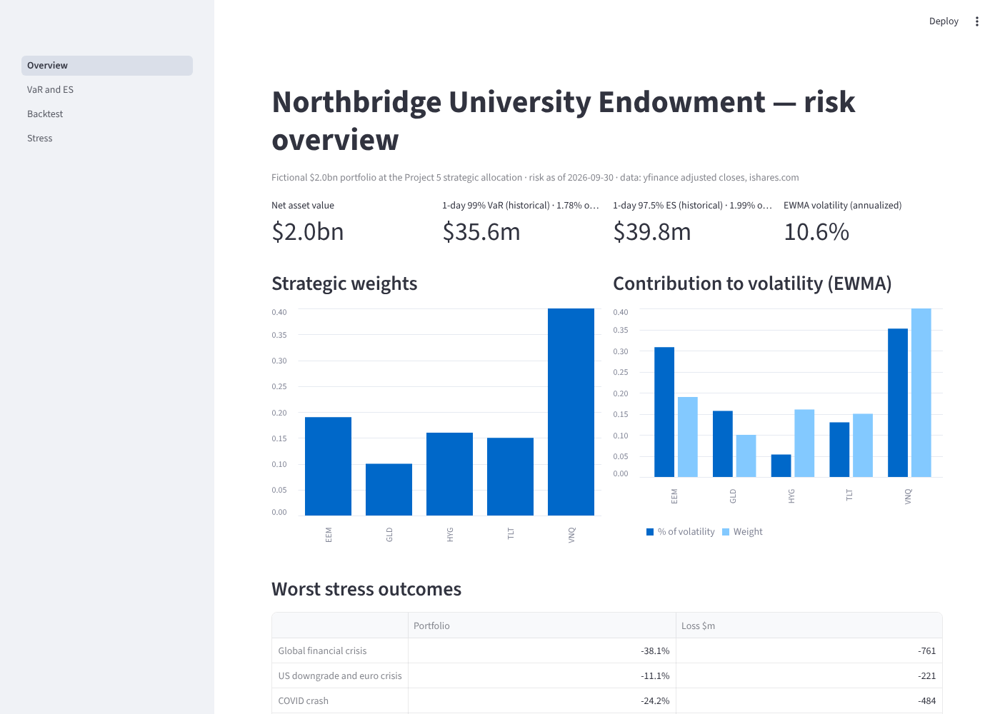

# 10 · Risk dashboard for the Northbridge portfolio

## Question
How much can the $2bn Northbridge portfolio (fictional; the Project 5 strategic allocation) lose in a day, in a crisis and in a hypothetical shock, and which VaR model can the investment committee trust?

## Answer
One-day 99% VaR on 30 September 2026 is $35.6m (1.78% of NAV) on historical simulation, the best-calibrated model since 2010 (41 exceptions vs. 42.1 expected). A replay of the global financial crisis on today's weights would cost 38.1% ($761m).

## Data
| Item | Source | File |
|---|---|---|
| Daily adjusted closes, 11 ETFs, May 2007 – 30 Sep 2026 | Yahoo Finance via `yfinance` | `data/etf_prices_daily.csv` |
| Portfolio weights: EEM 19%, TLT 15%, HYG 16%, VNQ 40%, GLD 10% | Project 5 final strategic allocation | `data/policy_weights.csv` |
| Effective duration, convexity, OAS and yield of TLT, HYG, IEF, TIP, LQD | Each fund's page on ishares.com (values as of 5–6 Oct 2026, the nearest available to 30 Sep) | `data/ishares_bond_characteristics.csv` |

## Method
1. **Three VaR models**, 1-day, at 95% and 99%, plus 97.5% Expected Shortfall, re-estimated every day: historical simulation (500-day rolling window); parametric normal with an EWMA covariance matrix (λ = 0.94, RiskMetrics); Monte Carlo with 10,000 draws from a multivariate Student-t (5 degrees of freedom) scaled to the EWMA covariance.
2. **10-day VaR** by √10 scaling, compared with overlapping 10-day historical returns.
3. **Backtest, Jan 2010 – Sep 2026 (4,211 days):** 99% VaR exceptions per model; Kupiec proportion-of-failures test; Christoffersen independence test; Basel traffic light (green 0–4, yellow 5–9, red 10+ exceptions in 250 days).
4. **Risk decomposition:** component VaR and percentage contribution to volatility per ETF (EWMA).
5. **Historical stress tests:** buy-and-hold ETF returns over the GFC (9 Oct 2007 – 9 Mar 2009), the US downgrade and euro crisis (22 Jul – 3 Oct 2011), the COVID crash (19 Feb – 23 Mar 2020) and the inflation shock (3 Jan – 12 Oct 2022), applied to today's weights.
6. **Hypothetical stress tests:** Recession (equities −30%, Treasury yields −100 bp, credit spreads +250 bp) and Stagflation (equities −20%, yields +150 bp, commodities +25%, gold +15%). Bond ETFs are revalued with duration and convexity. Equity shocks apply to EEM and VNQ.

| 99% VaR model | Exceptions / expected | Kupiec p | Christoffersen p | Basel zone now |
|---|---|---|---|---|
| Historical simulation | **41 / 42.1** | 0.863 | 0.001 | Green (1) |
| Parametric EWMA | 81 / 42.1 | 0.000 | 0.005 | Yellow (5) |
| Monte Carlo Student-t | 57 / 42.1 | 0.029 | 0.001 | Green (3) |

## Results






- Current 1-day VaR / ES ($m): historical 22.1 / 35.6 / 39.8 (95% / 99% / ES 97.5%); EWMA 21.7 / 30.7 / 30.9; Monte Carlo t 20.4 / 33.4 / 34.6.
- Only historical simulation passes Kupiec's test at 99%. The normal EWMA model has almost twice the expected exceptions because its tails are too thin, and Student-t tails close most of the gap. All three fail the independence test because exceptions cluster in crises.
- REITs and emerging markets are 59% of the weights and 66% of the volatility.
- Stress losses: GFC −38.1%, inflation shock 2022 −25.7%, COVID −24.2%, 2011 −11.1%, hypothetical recession −16.1%, stagflation −13.9%.

**Deliverables:** Streamlit app with four pages (Overview, VaR & ES, Backtest, Stress, including a build-your-own scenario) in `app/`; the 2-page committee report [`report/risk_report.pdf`](report/risk_report.pdf); and the notebook `notebooks/risk.ipynb`.

## Limitations
- iShares does not publish spread duration, so HYG's effective duration is used as its spread duration (equal to first order for fixed-rate bonds). Durations are as of 5–6 Oct 2026, not 30 Sep.
- Historical scenarios hold today's weights through the window with no rebalancing. Hypothetical shocks are instantaneous, and anything not specified in a scenario is set to zero.
- VaR uses today's weights on past returns and ignores intraday and liquidity risk. The 500-day historical window reacts slowly to new regimes.

## How to run
```bash
pip install -r ../requirements.txt
cd notebooks && jupyter nbconvert --to notebook --execute --inplace risk.ipynb && cd ..
python report/build_report.py
streamlit run app/Overview.py
```
`python -c "from src import ishares; ishares.snapshot().to_csv('data/ishares_bond_characteristics.csv')"` refreshes the iShares figures.
