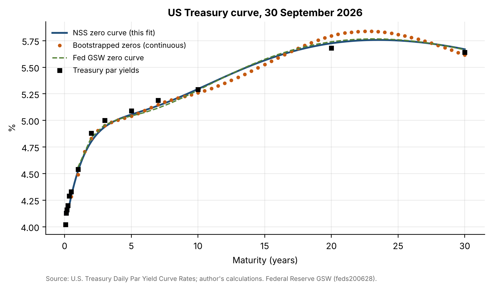
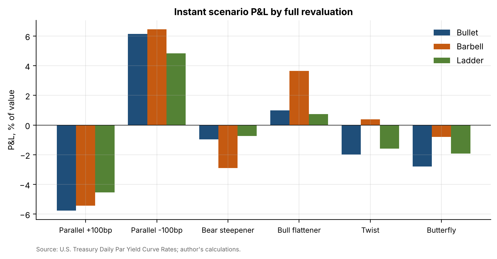
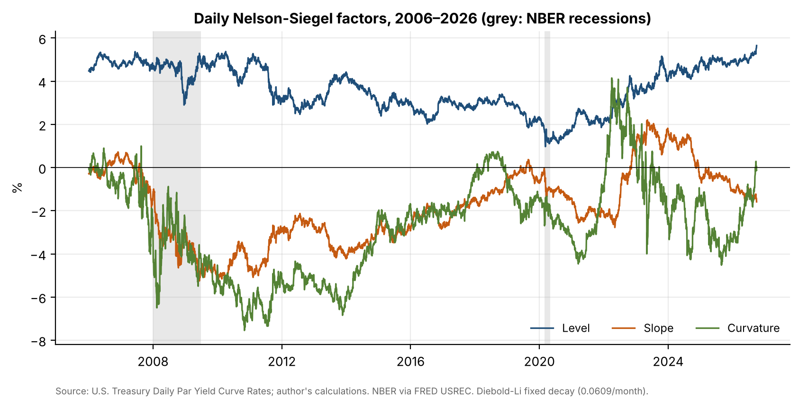

# 11 · Yield curve model and bond portfolio scenario tool

## Question
How do a 7-year bullet, a duration-matched 2/30-year barbell and a 1–10-year ladder ($100m each, priced off the 30 September 2026 US Treasury curve) react to curve shifts, and what does the barbell's convexity cost in carry?

## Answer
The duration-matched barbell gains 268 bp more than the bullet in a bull flattener (and loses 193 bp more in a bear steepener), while giving up 18.5 bp of 12-month carry and roll-down if the curve does not move.

## Data
| Item | Source | File |
|---|---|---|
| Daily Treasury Par Yield Curve Rates, Jan 2006 – 30 Sep 2026 (1 month to 30 years) | U.S. Treasury, home.treasury.gov | `data/treasury_par_yields_daily.csv` |
| GSW fitted Svensson parameters and zero-coupon yields (2006 onward, trimmed) | Federal Reserve, *The U.S. Treasury Yield Curve: 1961 to the Present* (feds200628.csv) | `data/gsw_zero_curve_2006_2026.csv` |
| NBER recession indicator | FRED `USREC` | `data/fred_USREC.csv` |

## Method
The package `yieldcurve/` has three modules: `curve.py` (bootstrapping, Nelson-Siegel, Svensson), `bonds.py` (pricing, yield, duration, convexity, portfolios) and `scenarios.py` (scenarios, P&L attribution, key rate durations, carry and roll-down).
1. **Bootstrap** the zero curve on 30 Sep 2026 from par yields on a semiannual grid, with cubic-spline-interpolated par yields. It reprices every par bond to 1e-12 bp.
2. **Nelson-Siegel-Svensson** fitted by nonlinear least squares to the par yields (18 starting points). It is compared with the Fed GSW zero rates at 2y/5y/10y/30y: errors of −3.9, +1.4, +1.2 and +0.5 bp. The fitted parameters are close to GSW's (β1 3.96% vs 3.93%, β3 16.95% vs 17.09%, τ2 16.2 vs 15.7).
3. **Daily Nelson-Siegel** (Diebold-Li fixed decay, OLS) for 5,191 days. Level, slope and curvature are charted with recessions shaded.
4. **PCA** of daily changes in the 1–30y yields: level 84.5%, slope 11.0%, curvature 2.4% (97.9% together).
5. **Portfolios**: bullet = 7y par bond; barbell = 68.6% 2y + 31.4% 30y, matching the bullet's modified duration of 5.81; ladder = equal amounts of 1–10y par bonds.
6. **Six instant scenarios** on zero rates: parallel ±100 bp, bear steepener, bull flattener, twist and butterfly.
7. **P&L** by full revaluation vs. duration-only vs. duration + convexity, plus key rate durations at 2/5/10/30y.
8. **12-month horizon return**, curve unchanged, split into carry (yield held constant) and roll-down.

| Scenario | Bullet | Barbell | Ladder | Barbell − bullet |
|---|---|---|---|---|
| Parallel +100bp | −5.76% | −5.42% | −4.54% | +34 bp |
| Parallel −100bp | +6.15% | +6.46% | +4.84% | +30 bp |
| Bear steepener | −0.97% | −2.90% | −0.73% | −193 bp |
| Bull flattener | +0.98% | +3.66% | +0.75% | **+268 bp** |
| Twist | −1.98% | +0.39% | −1.59% | +237 bp |
| Butterfly | −2.78% | −0.80% | −1.91% | +198 bp |
| **12m carry + roll-down** | **5.45%** | **5.27%** | **5.26%** | **−18.5 bp** |

## Results






- The barbell's extra convexity (102 vs. 40) earns about 30 bp in ±100 bp parallel moves; reshaping scenarios dominate the comparison.
- Duration-only approximations fail for non-parallel shifts. In the butterfly they show $0 for the barbell, but full revaluation gives −$0.80m because the 30-year's coupons sit in the shocked belly. Key rate durations capture this.
- The barbell's carry gap comes from a lower 2-year coupon and negative roll-down on the 30-year (−0.25%), which sits on the inverted 20–30-year segment.

**Deliverables:** the `yieldcurve/` package; the Streamlit page `app/scenario_tool.py` (curve date picker, presets and sliders for 2/5/10/30y shifts, live P&L, KRDs and carry); the 8-section report [`report/report.pdf`](report/report.pdf); and the notebook `notebooks/curve.ipynb`.

## Limitations
- Scenarios are instantaneous; no carry is earned while curves move.
- Treasury par yields are indicative on-the-run levels, so they include the 20-year sector's richness/cheapness. The spline bootstrap reproduces it as a hump.
- The daily NS fit uses a fixed decay and par yields; GSW uses off-the-run coupons and excludes bills.
- Shifts are applied to zero rates; shifting par yields instead would give slightly different P&L.

## How to run
```bash
pip install -r ../requirements.txt
cd notebooks && jupyter nbconvert --to notebook --execute --inplace curve.ipynb && cd ..
python report/build_report.py
streamlit run app/scenario_tool.py
```
