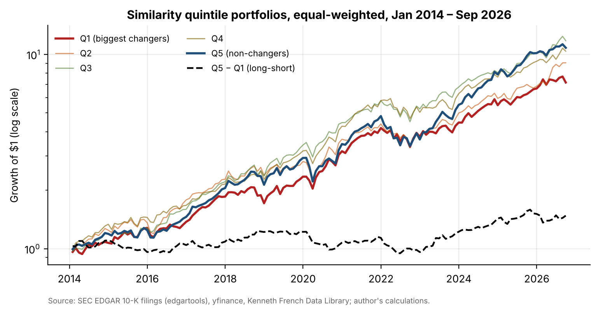
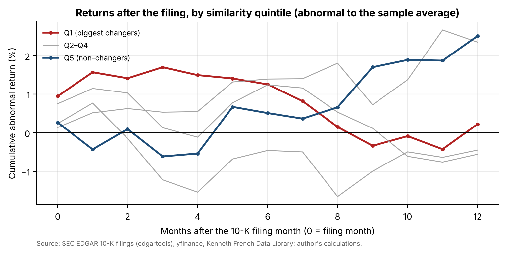
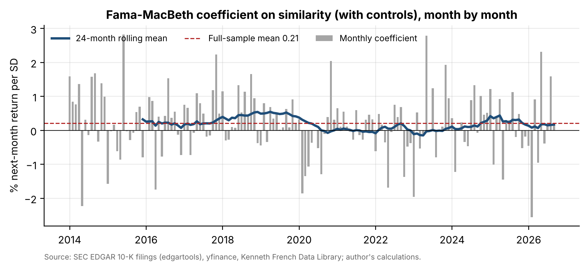

# 11 · Text as data: replicating "Lazy Prices" on the S&P 100

## Question
Do S&P 100 companies that change the wording of their 10-K a lot underperform those that barely change it, as Cohen, Malloy and Nguyen (2020) found for all US firms, and do dictionary or FinBERT tone scores add to the signal?

## Answer
The direction holds but the evidence is weak: long non-changers / short changers earned 0.29% a month from January 2014 to September 2026 (t = 1.26), with a Fama-French 5 + momentum alpha of 2.4% a year (t = 0.84). Fama-MacBeth regressions find a significant similarity effect (0.21% per SD, t = 2.89), and tone adds nothing.

## Data
| Item | Source | File |
|---|---|---|
| Universe: current S&P 100 (101 tickers, 100 firms) | Wikipedia list, 7 Oct 2026 | `data/sp100_constituents_wikipedia.csv` |
| 1,313 original 10-Ks, FY2012–2025: Item 1A and Item 7 | SEC EDGAR via `edgartools` (with regex and Exhibit 13 fallbacks) | `data/raw_10k/` (523 MB, not committed; rebuilt by `src/fetch_10k.py`, `fill_10k.py`, `repair_10k.py`) |
| Loughran-McDonald Master Dictionary 1993–2025 | Notre Dame SRAF | `data/external/` |
| FinBERT (ProsusAI/finbert) scores of 615,743 MD&A sentences | Hugging Face model, run locally | `data/finbert_mda.csv` |
| Monthly total returns, splits | yfinance | `data/returns_monthly.csv`, `data/prices_*.csv`, `data/splits.csv` |
| Shares outstanding → market cap | SEC XBRL (dei cover page; us-gaap fallback) | `data/market_cap_monthly.csv`, `data/shares_outstanding_xbrl.csv` |
| Fama-French 5 factors and momentum | Kenneth French Data Library | `data/ff5_monthly.csv`, `data/ff_momentum_monthly.csv` |
| Paper's results for comparison | Cohen, Malloy & Nguyen, NBER WP 25084 (Mar 2019), Tables I, II, IV | `data/comparison_with_paper.csv` |

## Method
1. **Cleaning:** drop table rows (more digits than letters), lowercase, keep alphabetic tokens only, remove stop words.
2. **Similarity:** cosine similarity of word-count vectors with the prior year's 10-K, for Item 1A, Item 7 and both combined.
   - A pair is used only if both years come from the 10-K itself, by the same extraction route, in consecutive years.
   - This gives 1,067 pairs from 94 firms.
3. **Dictionary tone:** Loughran-McDonald negative, uncertainty and litigious word shares, and their year-over-year changes.
4. **FinBERT tone:** mean of P(positive) − P(negative) over all MD&A sentences.
5. **Portfolio test, Jan 2014 – Sep 2026:**
   - Each month-end, rank firms on their latest similarity into quintiles (about 16 stocks each).
   - Long Q5 (non-changers), short Q1 (changers), equal-weighted, rebalanced monthly.
   - Report Sharpe, Newey-West t and FF5 + momentum alpha.
   - Robustness: each section separately, value-weighting, sub-periods, terciles and a sector-adjusted signal.
6. **Fama-MacBeth:** next-month return on similarity, Δ negative tone and FinBERT, controlling for log market cap, 12-1 momentum and the prior-month return. Reported raw and standardised.
7. **Event time:** abnormal returns in months 0–12 after the filing, by similarity quintile (does the market react at filing?).

## Results






| | Cohen, Malloy & Nguyen (2020) | This replication |
|---|---|---|
| Median cosine similarity | 0.947 | 0.985 |
| EW Q5 − Q1 return / month | 0.31% (t = 3.13) | 0.29% (t = 1.26) |
| EW Q5 − Q1 alpha / month | 0.32% (t = 4.21)* | 0.20% (t = 0.84) |
| VW Q5 − Q1 alpha / month | 0.34% (t = 2.53)* | −0.33% (t = −1.23) |
| Fama-MacBeth, similarity per SD | ≈0.06% | 0.21% (t = 2.89) |

\*The paper's alpha uses market, size, value, momentum and liquidity factors; this replication uses Fama-French 5 + momentum.

- **Which section:** the signal comes from Item 1A (Risk Factors, 0.29% a month); Item 7 alone gives −0.14%.
- **Sector:** a sector-adjusted signal gives the same 0.29%.
- **Timing:** there is no reaction in the filing month or the next three months. The gap opens in months 4–12 (+4.4% cumulative, t ≈ 1.5–1.7), consistent with the paper's inattention story.
- **Tone:** neither Loughran-McDonald nor FinBERT tone sorts returns (|t| ≤ 0.62), and neither weakens the similarity coefficient.

Full report (9 pages): [`report/lazy_prices_sp100.pdf`](report/lazy_prices_sp100.pdf).

## Limitations
- **Sample size:** about 78 firms a month, so about 16 stocks per quintile, against the whole US market in the paper. The test cannot detect a 0.3%-a-month effect reliably.
- **Survivorship bias:** the universe is today's S&P 100. Every quintile has a positive alpha, and the failures the paper links to big changes are missing.
- **10-Ks only:** 10-Qs are left out, so the signal is up to a year old.
- **Section extraction is imperfect:** pairs that mix extraction routes are dropped, which removes most banks' MD&A.
- **Tone models:** FinBERT was trained on news and analyst text, not 10-Ks. Tone is measured on the whole section, not only on the changed text.
- **Costs:** returns are before trading costs.

## How to run
```bash
pip install -r ../requirements.txt edgartools transformers torch
python src/fetch_10k.py && python src/fill_10k.py && python src/repair_10k.py   # 10-K sections -> data/raw_10k/
python src/build_sections.py      # similarity and Loughran-McDonald features -> data/text_features.csv
python src/finbert.py             # FinBERT scores (several hours on CPU; resumable) -> data/finbert_mda.csv
python src/market.py              # returns and market caps
cd notebooks && jupyter nbconvert --to notebook --execute --inplace lazy_prices.ipynb && cd ..
python report/build_report.py
```
