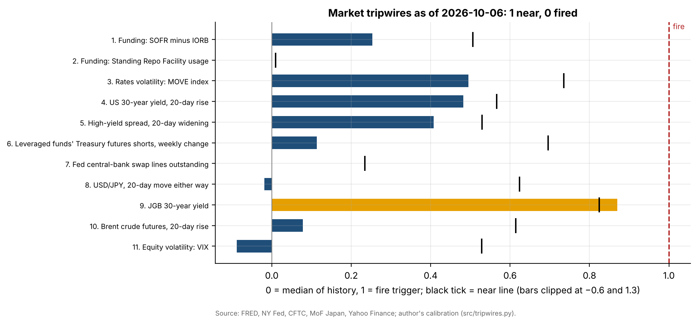
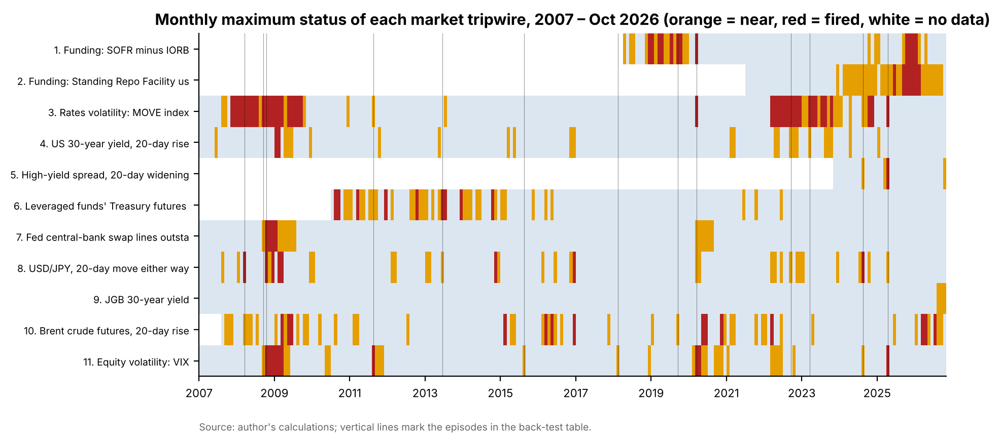
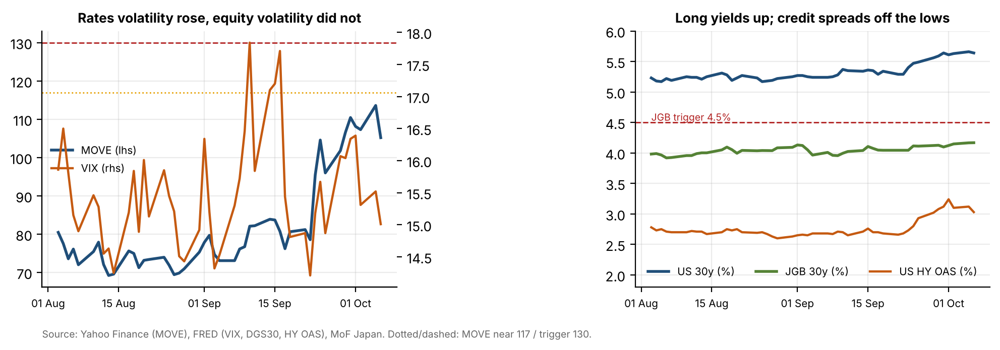

# 16 · Market stress tripwires: weekly check

## Question
Is the financial system bending or breaking? This project scores 17 tripwires (eleven market gauges and six events) as of 7 October 2026. Each market trigger is set from the gauge's own history.

## Answer
Bending, not breaking: 0 of 17 tripwires fired and 4 are near their line. The four are the JGB 30-year yield (4.168%), record private credit defaults, Q3 redemption requests above the 5% cap at large private credit funds, and an A-CAP life insurer downgrade. MOVE (105–114) stayed well short of its 130 trigger.

## Data
| Tripwire | Series | Source | File |
|---|---|---|---|
| 1 Funding | SOFR minus IORB (IOER before Jul 2021) | NY Fed, Federal Reserve (FRED) | `data/raw/fred_SOFR.csv`, `fred_IORB.csv`, `fred_IOER.csv` |
| 2 Funding | Standing Repo Facility usage | NY Fed repo operations (FRED RPONTSYD) | `data/raw/fred_RPONTSYD.csv` |
| 3 Rates volatility | ICE BofA MOVE index | Yahoo Finance ^MOVE | `data/raw/yahoo_MOVE.csv` |
| 4 Long yields | US 30-year (and 10-year) Treasury yield | FRED DGS30, DGS10 | `data/raw/fred_DGS*.csv` |
| 5 Credit | ICE BofA US High Yield OAS | FRED BAMLH0A0HYM2 (3 years) | `data/raw/fred_BAMLH0A0HYM2.csv` |
| 6 Basis trade | Leveraged funds' shorts in six CBOT Treasury futures, $ face value | CFTC Traders in Financial Futures, 2010–2026 | `data/raw/cftc_fin_*.zip` → `data/cftc_leveraged_shorts_weekly.csv` |
| 7 Dollar funding | Fed central-bank liquidity swaps | Fed H.4.1 (FRED SWPT) | `data/raw/fred_SWPT.csv` |
| 8 Yen | USD/JPY | Fed H.10 (FRED DEXJPUS) | `data/raw/fred_DEXJPUS.csv` |
| 9 Japan | JGB 30-year benchmark yield | Ministry of Finance Japan | `data/raw/mof_jgb_*.csv` |
| 10 Oil | Brent front-month futures (and Dated Brent spot for reference) | Yahoo Finance BZ=F; EIA via FRED | `data/raw/yahoo_BZ_F.csv`, `fred_DCOILBRENTEU.csv` |
| 11 Equity volatility | VIX | Cboe via FRED VIXCLS | `data/raw/fred_VIXCLS.csv` |
| 12–17 Events | Private credit defaults, bank failures and Fed emergency lending, life insurers, private credit redemptions, GPU-backed debt, Treasury margins and clearing | Fitch, FDIC, Federal Register, AM Best, Reuters, Bloomberg, SIFMA and others (URLs per row) | `data/events.csv` |

## Method
- **Calibration** (`src/tripwires.py`):
  - Each market trigger comes from the series' own history up to 31 Dec 2025, so 2026 is out of sample.
  - **near** = 95th percentile, **fire** = 99th percentile. For the weekly change in leveraged funds' shorts, the downside tail is used: 5th and 1st percentiles.
  - Level gauges are tested on their level: funding spreads, repo use, swap lines, VIX.
  - Trending series are tested on their 20-observation speed: US 30-year yield, HY spread, Brent, and the absolute move in USD/JPY.
  - The user set two triggers, MOVE 130 and JGB 30-year 4.5%. For those, near = within 10% of the trigger.
- **Weekly check:** uses the last complete session before the check date, and the value a week earlier.
- **Event tripwires:** a written rule for each, checked against dated news sources.
- **Back-test:** status of every market tripwire on each business day since 2007, read at 13 known stress episodes.
- **Fact-check:** every number in the 7 October draft note was checked against its primary source (`data/corrections_to_draft.csv`).

## Results






| Tripwire (latest) | Status |
|---|---|
| JGB 30y 4.168% (6 Oct); near 4.05%, fire 4.5% | near |
| MOVE 105.2 (6 Oct; 113.6 on 5 Oct); near 117, fire 130 | ok |
| US 30y 5.64%, +39bp in 20 days; near +46bp | ok |
| HY OAS 3.03%, +36bp in 20 days; near +49bp | ok |
| Leveraged funds' UST shorts $1.079tn, −1.1% w/w; near −8.8% | ok |
| Fitch private credit default rate 6.3% (August, record) | near |
| Q3 redemption requests 11.5–16.8% at five large funds, all prorated to 5% | near |
| AM Best cut two A-CAP life insurers to C+ | near |

- **Back-test:** at least one tripwire fired in 10 of 13 stress episodes since 2008. The 2013 taper tantrum, the 2015 devaluation and the February 2018 volatility spike only reached near.
- **Frequency:** one or more tripwires fired on 13% of business days since 2007, and three or more on 0.9%.
- **Draft corrections:**
  - **MOVE:** the "~116, highest since Apr 2025" claim is wrong. The close was 113.6, and 26 Mar 2026 was higher at 115.0.
  - **HY spread:** the +19bp change and the VIX figure were stale.
  - **JGB 30-year:** MoF data show +16bp over the month, not +25bp.
  - **Auctions:** the 3-, 10- and 30-year auctions were on 6–8 Oct, not mid-October.
  - **FOMC:** hike odds are about 18–20%, not 25%.

Full weekly check (5 pages): [`report/weekly_check_2026-10-07.pdf`](report/weekly_check_2026-10-07.pdf).

## Limitations
- **Statistical thresholds:** a 99th percentile is rare, not necessarily dangerous.
  - Swap lines fire only at crisis scale ($475bn).
  - Repo facility use is near or fired at most quarter-ends since 2024.
- **Short histories:** HY spread (3 years on FRED), repo facility (2021) and SOFR (2018).
- **Data lags:** USD/JPY (H.10) and JGB yields lag by a day or more.
- **Event checks depend on news search:** some pages were blocked or paywalled, so those rows rest on search excerpts. "None found" is not proof of absence.
- **Event rules are judgement calls:** they are written down in `data/events.csv` and can be edited.

## How to run
```bash
python src/fetch.py          # download all market data to data/raw/
python src/series.py         # build data/indicators_daily.csv and the CFTC weekly series
# update data/events.csv with this week's event evidence
cd notebooks && jupyter nbconvert --to notebook --execute --inplace tripwires.ipynb && cd ..
python report/build_report.py
```
