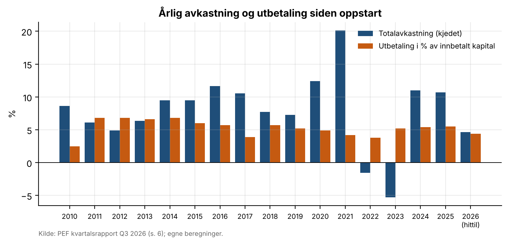
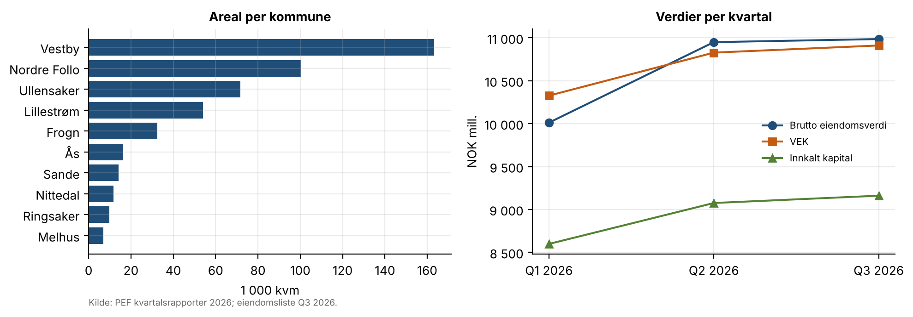
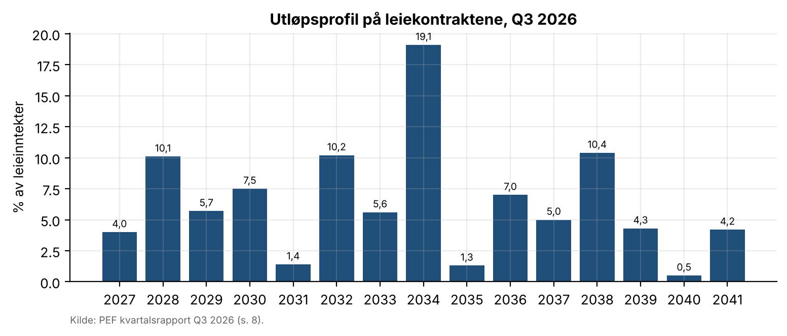

# 17 · Kvartalsrapport: gjenbrukbar investorrapport

## Spørsmål
Hvordan ser en investorrapport for et eiendomsfond ut når den bygges fra en mal som kan oppdateres raskt? Eksempelet er Pareto Eiendomsfellesskap IS/AS (PEF) i 3. kvartal 2026. Rapporten dekker porteføljestatus, leieinntekter, utleiegrad og avkastning (direkteavkastning, IRR og multipler).

## Svar
PEF har 39 logistikkbygg på 480 823 kvm, en eiendomsverdi på NOK 10 986 mill. og NOK 622 mill. i leieinntekter. Økonomisk utleiegrad er 97,3 %.
- **Avkastning:** 1,1 % i kvartalet og 7,7 % siste 12 måneder (kjedet). Forvalter oppgir 7,8 % IRR siden 2009, og de kjedede kvartalstallene gir 8,0 % annualisert.
- **Multipler:** DPI 0,33x og TVPI 1,52x.
- **Avstemming:** alle tallene stemmer med forvalters egne innenfor avrunding.

## Data
| Hva | Kilde | Fil |
|---|---|---|
| Nøkkeltall per kvartal Q1–Q3 2026 (VEK, innkalt kapital, utbetalinger, eiendomsverdi, leie, yield, ledighet, leietid, areal) | PEF kvartalsrapporter Q1, Q2 og Q3 2026, s. 4–8 (paretoai.no/reports) | `data/kvartalstall_PEF.csv` |
| Kvartalsavkastning og utbetalinger 2010–2026 | Q3 2026-rapporten s. 6 (omregnet til kjedet IRR-metode) | `data/kvartalsavkastning_PEF.csv` |
| Eiendomsliste med leietakere og areal | Q3 2026-rapporten s. 9–10 | `data/eiendommer_PEF_Q3_2026.csv` |
| Utløpsprofil 2027–2041 | Q3 2026-rapporten s. 8 | `data/utlopsprofil_PEF_Q3_2026.csv` |
| Daterte kontantstrømmer 31.03–30.09.2026 | Utbyttedatoer, reinvestert utbytte og innkalt kapital fra Q1–Q3-rapportene (forutsetninger i kildekolonnen) | `data/kontantstrommer_PEF_2026.csv` |

## Metode
- **Malen** (`model/kvartalsrapport_mal.xlsx`):
  - Arket **Input** har én kolonne per kvartal, og kvartalet velges i B2.
  - **Historikk**, **Eiendommer**, **Utløpsprofil** og **Kontantstrømmer** limes inn fra rapporten.
  - **Nøkkeltall** er bare formler (INDEX/MATCH på valgt kvartal), og **Kontroller** avstemmer rapportens egne tall.
- **Nøkkeltall:**
  - Økonomisk utleiegrad = 1 − økonomisk ledighet.
  - Direkteavkastning = utbetalinger siste fire kvartaler i % av innbetalt kapital, og netto yield på eiendomsnivå.
  - IRR = XIRR på daterte kontantstrømmer med VEK ved start og slutt.
  - Kjedet avkastning = produktet av (1 + kvartalsavkastning).
  - DPI, RVPI og TVPI regnes mot innkalt kapital.
- **Rapporten** (`src/lag_rapport.py`):
  - Regner om arbeidsboken i LibreOffice og kontrollerer fem nøkkeltall mot en uavhengig Python-beregning.
  - Lager deretter PDF-en med figurer.

## Resultater






| Nøkkeltall, Q3 2026 | Verdi |
|---|---|
| Brutto eiendomsverdi / leieinntekter | NOK 10 986 mill. / NOK 622 mill. |
| Økonomisk utleiegrad / vektet leietid | 97,3 % / 7,3 år |
| Avkastning kvartal / hittil i år / siste 12 mnd | 1,1 % / 4,7 % / 7,7 % |
| IRR siden oppstart: rapportert / kjedet annualisert | 7,8 % / 8,0 % |
| IRR 31.03–30.09.2026 (XIRR) | 5,26 % per år (2,60 % for halvåret) |
| Utbetaling siste fire kvartaler / netto yield | 5,8 % av innbetalt kapital / 5,8 % |
| DPI / RVPI / TVPI | 0,33x / 1,19x / 1,52x |

**Avvik som malen fanger opp:**
- Kjedede kvartalstall gir 255,9 % mot rapportert 255,2 %, som er avrunding.
- Eiendomslisten summerer til 1 kvm mer enn oppgitt totalareal.
- Q2-rapporten og Q3-rapporten oppgir ulik utbetaling for Q2 2026 (1,4 % mot 1,5 %).
- VEK-broen for Q2 gir 1,44 % mot rapportert 1,6 %.

Rapport (4 sider): [`report/investorrapport_Q3_2026.pdf`](report/investorrapport_Q3_2026.pdf).

## Begrensninger
- **IRR siden oppstart kan ikke regnes uavhengig.** De daterte kontantstrømmene siden 2009 er ikke offentlige, så malen bruker forvalters tall og viser kjedet avkastning ved siden av. Egen IRR regnes bare for 31.03–30.09.2026.
- **Datoene for innkalling av ny kapital er ikke oppgitt.** Malen antar 26. juni (avsluttet kapitalinnhenting) og at reinvestert utbytte innkalles samme dag som utbetalingen.
- **Malen leser ikke rapportene selv.** Tallene må legges inn manuelt fra PDF-en, og Kontroller-arket fanger opp feil i innlegging.
- **Dette er en egen fremstilling**, ikke et dokument fra Pareto Alternative Investments.

## Slik kjører du
```bash
python src/hent_kilder.py      # laster ned PEFs kvartalsrapporter (kilder)
python src/lag_mal.py          # bygger malen fra data/ (bare første gang; deretter oppdateres Excel-filen direkte)
python src/lag_rapport.py      # regner om malen, kontrollerer og lager report/investorrapport_<kvartal>.pdf
```
