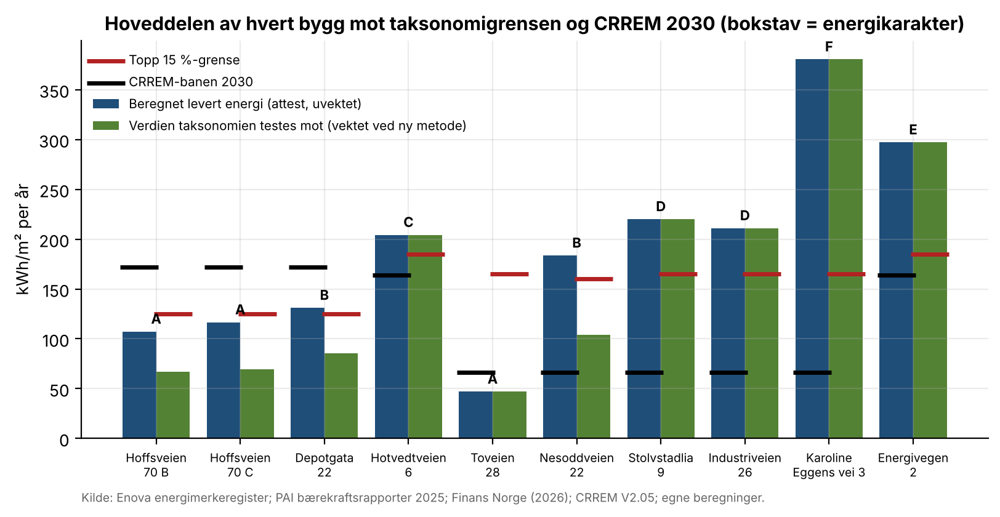
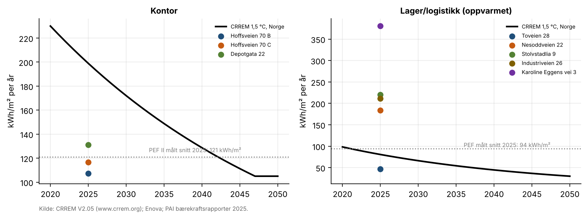
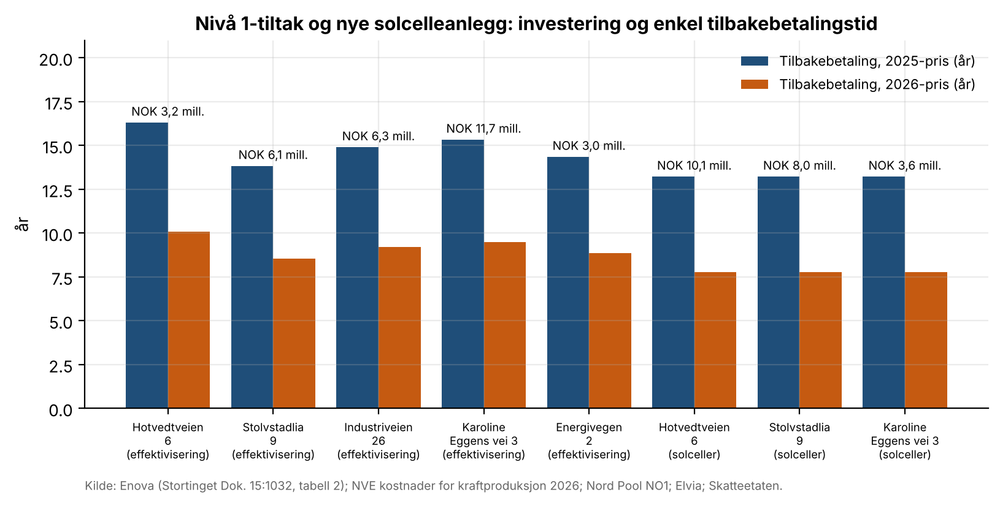

# 18 · Energi- og klimakartlegging av ti næringsbygg

## Spørsmål
Hvor står ti næringsbygg i Pareto Eiendomsfellesskap (PEF) og PEF II på energibruk og energimerke? Hvordan ligger de an mot EU-taksonomien og CRREM-banene? Hvilke tiltak trengs, hva koster de, og hvor lang er tilbakebetalingstiden?

## Svar
Byggene er kontor, handel og logistikk på til sammen 94 500 kvm oppvarmet areal. De bruker beregnet 14,0 GWh i året.

- **Utslipp:** 132 tonn CO₂e med NVEs faktor for 2025 (9,4 g/kWh), og 1 909 tonn med europeisk strømmiks (NS 3720, 136 g/kWh).
- **EU-taksonomien (7.7):**
  - 5 av 10 bygg (57 % av arealet) oppfyller energikriteriet, enten med energimerke A eller ved å ligge blant de 15 % beste.
  - Alle bygg med ny attest fra 2026 er innenfor.
  - De fem byggene utenfor har alle eldre attest. En indikasjon fra 2026-attestene tyder på at ny metode ville tatt tre av dem (Hotvedtveien 6, Stolvstadlia 9, Industriveien 26) under grensen, men ikke Karoline Eggens vei 3 eller Energivegen 2.
- **CRREM 1,5 °C (Norge, V2.05):**
  - Kontorbyggene krysser energibanen først i 2040-årene.
  - Lagerbyggene med beregnet bruk over 180 kWh/m² ligger allerede over logistikkbanen, som er 66 kWh/m² i 2030.
  - Det samme gjelder PEFs målte snitt (94 kWh/m²), så banen er svært krevende for norske lagre.
  - Mot CO₂-banen ser det mye bedre ut, fordi norsk strøm har lav utslippsfaktor.
- **Tiltaksplan:**

  | Nivå | Besparelse | Investering | Tilbakebetaling |
  |---|---|---|---|
  | Nivå 1, til taksonomigrensen | 2 519 MWh/år | NOK 30,3 mill. | 14–16 år med 2025-pris, 9–10 år med 2026-pris |
  | Nivå 1 og 2, videre til CRREM 2030 | 5 978 MWh/år | NOK 72,2 mill. | – |
  | Solceller på tre tak (3,0 MWp) | 2 298 MWh/år | NOK 21,6 mill. | 13,2 år med 2025-pris, 7,8 år med 2026-pris |

  Det billigste første steget er en ny energiattest etter ny metode.

## Data
| Hva | Kilde | Fil |
|---|---|---|
| Alle energiattester for byggene: karakter, levert energi og vektet levert energi (ny metode) | Enova, Energimerkesystemet – offentlige data (API, årsfiler 2010–2025 og månedsfiler 2026). Eierselskap sjekket i Enhetsregisteret | `data/energiattester_10_bygg.csv` |
| Fordeling av levert energi per bygningskategori i registeret | Samme | `data/register_fordeling_per_kategori.csv` |
| Oppvarmet areal, segment og eksisterende solceller | PEF og PEF II bærekraftsrapporter 2025 (paretoai.no) | `src/analyse.py` (BYGG) |
| Topp 15 %-grenser | Finans Norge, «Veileder for vurdering av taksonomiforenlig eiendom», juni 2026, Vedlegg B. NVE/Norconsult 2024 | `src/analyse.py` (TOPP15) |
| CRREM-baner for Norge, energi og CO₂ | CRREM Pathways V2.05 og Emission Factors V2.05 (www.crrem.org) | `data/crrem_norge.csv` (bare Norge-utdrag) |
| Kostnad per spart kWh første år per tiltakstype | Stortinget Dok. 15:1032 (2024–2025), svar fra energiministeren, tabell 2 (Enovas energitilskudd, 3 912 tiltak) | `data/enova_tiltakskostnader.csv` |
| Kostnad og ytelse for solceller | NVE, «Kostnader for kraftproduksjon» 2026 (store flate tak) | `src/analyse.py` (SOL) |
| Spotpris NO1 per dag | Nord Pool via hvakosterstrommen.no | `data/spotpris_NO1_daglig.csv` |
| Nettleie og avgift | Elvia energiledd for store bedrifter fra 1.7.2026; Skatteetaten, elavgift 2026 | `src/analyse.py` |

Kildefilene (Enova-registeret, CRREM-arbeidsbøkene og PDF-ene) lastes ned til `data/kilde/`, som ikke er med i repoet. CRREM-vilkårene tillater ikke videredistribusjon av hele filen.

## Metode
1. **Energibruk:** siste attest per bygg og bygningsdel. Hoveddelen etter PAIs segment bærer arealet, med arealvekting der attestene oppgir areal per del.
2. **Taksonomi:**
   - Attester fra 2026 testes på vektet levert energi mot de offisielle grensene: kontor 125, forretning 185, lager 160.
   - Eldre attester testes på levert energi mot NVE/Norconsults grenser: 130, 185 og 165.
   - Energimerke A er alltid innenfor.
3. **CRREM:** energiintensiteten sammenlignes med banen for riktig byggtype (Office, Retail Warehouse, Distribution Warehouse Warm). CO₂ beregnes med CRREMs egen utslippsfaktor for norsk strøm.
4. **Tiltak:**
   - Hvert bygg får en tiltakspakke valgt ut fra type, alder og karakter.
   - Investeringen er kutt (kWh) × Enovas snittkostnad per spart kWh for pakken.
   - Enkel tilbakebetaling er kostnad per kWh delt på strømpris (spot NO1 + energiledd + elavgift, eks. mva.).
   - Nivå 1 går til taksonomigrensen. Nivå 2 går videre til CRREM 2030.
5. **Solceller:** kapasiteten skaleres med PEF-lagrenes median kWp per m² (0,113). Kostnad, ytelse og drift er fra NVE.
6. **Modell:**
   - `model/energi_klima_modell.xlsx` har alle forutsetninger som input og alle avledede celler som formler.
   - `src/sjekk_modell.py` regner om i LibreOffice og sammenligner med Python.

## Resultater






| Eiendom | Fond | Type | Areal (m²) | Karakter | kWh/m² | Taksonomi | Over CRREM-energibanen fra |
|---|---|---|---|---|---|---|---|
| Hoffsveien 70 B | PEF II | Kontor | 7 450 | A | 107 | ja | 2047 |
| Hoffsveien 70 C | PEF II | Kontor | 5 115 | A | 117 | ja | 2044 |
| Depotgata 22 | PEF II | Kontor | 5 800 | B | 131 | ja | 2040 |
| Hotvedtveien 6 | PEF II | Handel | 12 487 | C | 204 | nei | 2023 |
| Toveien 28 | PEF | Lager | 30 440 | A / A | 47 | ja | 2039 |
| Nesoddveien 22 | PEF | Terminal/lager | 5 201 | A / B | 184 | ja | før 2020 |
| Stolvstadlia 9 | PEF | Lager | 9 887 | E / D | 220 | nei | før 2020 |
| Industriveien 26 | PEF | Lager | 11 399 | D / F | 211 | nei | før 2020 |
| Karoline Eggens vei 3 | PEF | Lager | 4 401 | D / F | 380 | nei | før 2020 |
| Energivegen 2 | PEF II | Salg/verksted | 2 320 | E / C | 297 | nei | før 2020 |

Rapport (5 sider): [`report/energi_klima_kartlegging.pdf`](report/energi_klima_kartlegging.pdf).

## Begrensninger
- **Beregnet bruk:** energien er beregnet (energiattest), ikke målt. Målt forbruk er bare offentlig på porteføljenivå.
- **Arealfordeling:** for bygg med flere deler er fordelingen ukjent, så hoveddelen bærer hele arealet.
- **Kostnader:** Enovas snitt gjelder støttede prosjekter, som kan være dyrere enn typiske tiltak.
- **Tilbakebetaling:** den er enkel og udiskontert, uten effektledd eller vedlikeholdsgevinst.
- **Taksonomien:** bare energikriteriet er vurdert, ikke DNSH eller minimumsgarantier.
- **Ny metode:** indikasjonen bygger på få 2026-attester.

## Slik kjører du
```bash
export ENOVA_API_KEY=...          # gratis nøkkel fra api.data.enova.no
python src/hent_enova.py          # laster ned registeret og trekker ut byggene
python src/crrem.py               # krever crrem_pathways_v2.05.xlsx i data/kilde/
python src/hent_strompris.py
cd src && python analyse.py && python lag_modell.py && python sjekk_modell.py && cd ..
python src/lag_rapport.py
```
