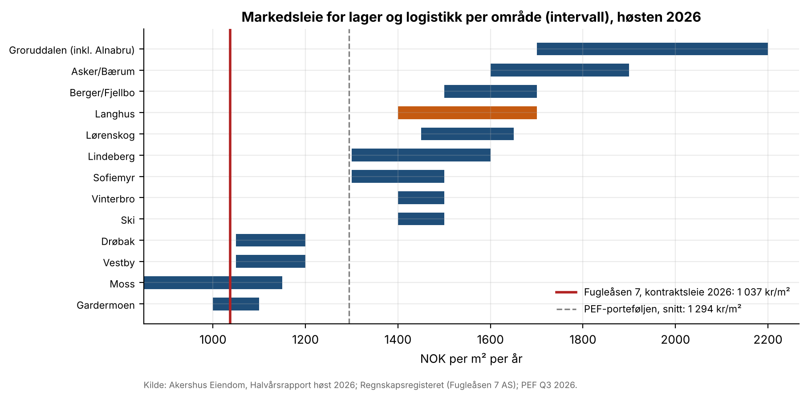
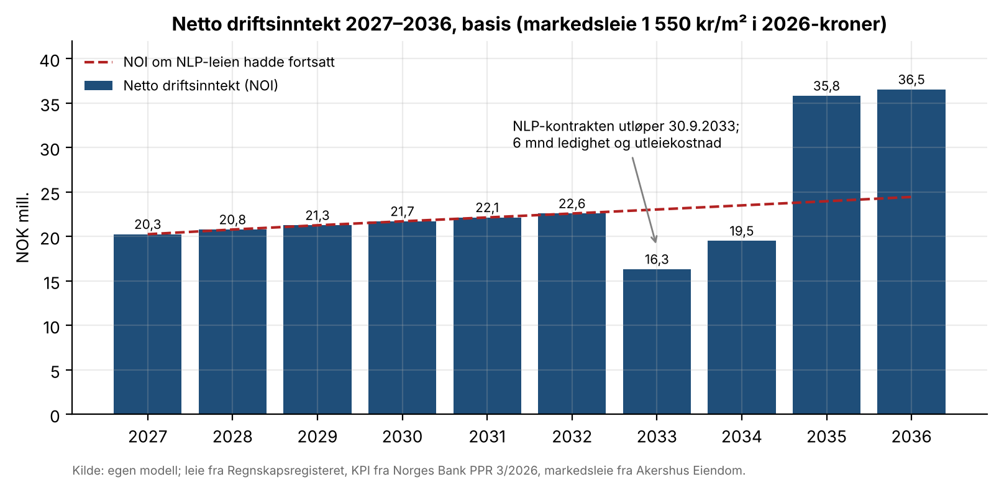
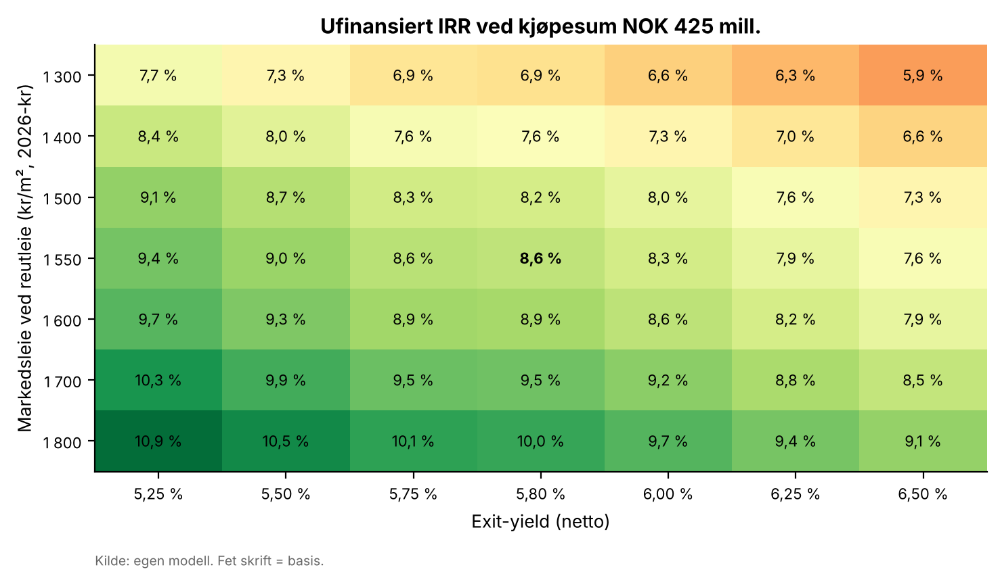

# 15 · Investeringscase: Fugleåsen 7, Langhus

## Spørsmål
Hva bør vi by for et reelt logistikkbygg i Oslo-området, og hvilken avkastning gir det? Caset er Fugleåsen 7 på Langhus: 21 012 m², utleid til Norsk Lastbærer Pool AS (NLP) og eid av Pareto Eiendomsfellesskap.

Leveransen består av:
- en Excel-modell med kontantstrøm, yield, IRR og sensitivitet på leienivå og exit-yield,
- markedsleie og sammenlignbare transaksjoner,
- en vurdering av motpartsrisikoen hos leietakeren,
- et kort memo og en PowerPoint-versjon.

## Svar
**Anbefaling: by NOK 425 mill.** Det tilsvarer 20 227 kr/m² og en netto startyield på 4,77 %.

| Nøkkeltall ved budet | Verdi |
|---|---|
| IRR, ufinansiert (10 år) | 8,6 % mot krav på 7,5 % |
| Multippel, ufinansiert | 2,03x |
| IRR, egenkapital (55 % lån til 6,2 %) | 10,6 % |
| Maks pris ved kravet, basis | NOK 462 mill. |
| Maks pris ved nedre markedsleie | NOK 427 mill. |

- **Hvorfor caset virker:** NLP betaler om lag 1 037 kr/m² i 2026. Markedsleien på Langhus er 1 400–1 700 kr/m², og kontrakten utløper trolig 30.9.2033. Om lag 23 % av verdien kommer fra reutleie over dagens leie.
- **Hvorfor vi byr lavere enn maks pris:** budet bygger på nedre markedsleie (1 400 kr/m²), ikke midtpunktet. Da betaler vi ikke fullt for en gevinst som ligger sju år frem.
- **Sammenligning:** budet ligger mellom de to KLP-handlene i 2025–2026, som ble gjort til 18 400–21 200 kr/m².
- **Sensitivitet:** caset tåler 1 400 kr/m² og 6,0 % exit-yield, og gir da 7,3 %.
- **Hovedrisikoen:** NLP fornyer til dagens leie. Da faller IRR til 5,1 %.
- **Motparten:** NLP er solid.
  - Omsetning 569 mill. kr, egenkapitalandel 44 %.
  - Leien utgjør 3,7 % av omsetningen, og (driftsresultat + leie) / leie er 3,4x.
  - Risikoen ligger i fornyelsen, ikke i betalingsevnen.

## Data
| Hva | Kilde | Fil |
|---|---|---|
| Leien (driftsinntektene til eierselskapet Fugleåsen 7 AS, 2023–2025) | Regnskapsregisteret, org.nr. 999296947 | `data/fugleasen7_as_regnskap.csv` |
| NLPs regnskap 2023–2025 | Regnskapsregisteret, org.nr. 990043132 (revidert, Deloitte) | `data/leietaker_regnskap.csv` |
| Areal, leietaker og energimerke | PEF kvartalsrapport Q3 2026; PEF bærekraftsrapport 2025 (paretoai.no) | `data/markedsdata.csv` |
| Leieavtalen: 20 år, i drift oktober 2013 | tungt.no / Logistikk & Ledelse, 1.3.2012 | `data/markedsdata.csv` |
| Markedsleie per område og prime yield | Akershus Eiendom, Halvårsrapport høst 2026 | `data/markedsleie_omrader.csv`, `data/markedsdata.csv` |
| Prime yield, snittleie, volum | DNB Næringsmegling, Sektoroppdatering 21.9.2026; Catella Logistics Map Q2 2026 | `data/markedsdata.csv` |
| PEF-porteføljens netto yield (5,8 %) og snittleie | PEF kvartalsrapport Q3 2026 | `data/markedsdata.csv` |
| Sammenlignbare transaksjoner | MT Logistikk; Konkurransetilsynet; KLP/NTB; Colliers; Wästbygg; Logistikk Inside; DNB Næringsmegling; Estate Nyheter | `data/transaksjoner.csv` |
| KPI-anslag og styringsrente | Norges Bank, Pengepolitisk rapport 3/2026 | `data/markedsdata.csv` |
| 10-årig statsrente 29.10.2026 | Norges Bank, rentestatistikk (API) | `data/markedsdata.csv` |
| Bankrente for næringseiendom | Newsec Property Outlook høst 2026 | `data/markedsdata.csv` |
| KPI-regulering av leie | Finanstilsynet, Finansielt utsyn juni 2026 | `data/markedsdata.csv` |
| Energiattester for Fugleåsen | Enova, Energimerkesystemet | `data/energiattester_fugleasen.csv` |

## Metode
**Kontantstrøm.**
- Kjøp 31.12.2026 og salg 31.12.2036.
- Leien for 2025 reguleres med KPI. Leien i år *t* følger KPI for år *t − 1* (Norges Bank 2026–2029, deretter 2 %).
- NLP-kontrakten løper til 30.9.2033. Deretter står bygget tomt i 6 måneder, og så leies det ut til markedsleie.
- Eierkostnader er 10 % av leien, og utleiekostnaden er 15 % av første års nye leie.
- Salgsverdien er NOI 2037 / exit-yield, fratrukket 1 % salgskostnad. Kjøpskostnaden er 1 %.

**Avkastning.**
- IRR og multippel, både ufinansiert og på egenkapitalen (avdragsfritt lån).
- Maks bud er nåverdien ved avkastningskravet.
- Budet er maks bud ved nedre markedsleie, avrundet ned til nærmeste 5 mill.

**Antagelser.** Disse er ikke observerte tall:

| Antagelse | Verdi | Begrunnelse |
|---|---|---|
| Markedsleie | 1 550 kr/m² | Midt i Akershus Eiendoms intervall |
| Exit-yield | 5,8 % | PEFs egen verdsettelse |
| Avkastningskrav | 7,5 % | Prime yield 5,5 % + KPI-mål 2 %, eller 10-års stat 4,4 % + 3 % premie |
| Ledighet | 6 mnd | – |
| Utleiekostnad | 15 % | – |
| Belåning | 55 % | – |

**Sensitivitet.**
- NOI er lineær i markedsleien (kontraktsdel + markedsleie × koeffisient). Hvert punkt i gitteret 7 × 7 (markedsleie × exit-yield) er derfor én formelrad i Excel.
- Fire navngitte scenarier: reutleie, fornyelse til markedsleie, fornyelse til dagens leie og et svakt scenario.

**Kontroll.** `src/sjekk_modell.py` regner om Excel-modellen i LibreOffice og sammenligner med Python-modellen:
- nøkkeltall, NOI per år og alle 49 gitterpunkter,
- kontrollarket,
- de fire scenariene, som kjøres ved å endre inndata.

Alt stemmer til avrundingsfeil.

## Resultater






| Scenario (kjøpesum 425 mill.) | IRR ufinansiert | IRR belånt | Maks pris ved 7,5 % |
|---|---|---|---|
| Basis: reutleie etter 6 mnd | 8,6 % | 10,6 % | 462 |
| NLP fornyer til markedsleie | 8,9 % | 11,3 % | 475 |
| NLP fornyer til dagens leie | 5,1 % | 3,8 % | 355 |
| Svak: 12 mnd ledig, 1 400 kr/m², exit 6,25 % | 6,6 % | 7,1 % | 398 |

**Leveranser:**
- Excel-modell: [`model/fugleasen7_investeringscase.xlsx`](model/fugleasen7_investeringscase.xlsx). Arkene er Forutsetninger, Kontantstrøm, Scenarier, Sensitivitet, Marked, Leietaker og Kontroller.
- Memo (4 sider): [`report/investeringsmemo_fugleasen7.pdf`](report/investeringsmemo_fugleasen7.pdf).
- PowerPoint (10 lysbilder): [`report/investeringscase_fugleasen7.pptx`](report/investeringscase_fugleasen7.pptx).

## Begrensninger
- **Leien:** den er utledet av eierselskapets driftsinntekter, ikke av leiekontrakten. Inntektene kan inneholde annet, for eksempel solstrøm (187 kWp på taket) eller viderefakturering, og veksten i 2024 (7,6 %) var høyere enn KPI.
- **Utløpet:** datoen 30.9.2033 bygger på en artikkel fra 2012. Opsjoner, indeksering og garantier er ikke offentlige.
- **Eierkostnader:** 10 % er en sjablong. Eierselskapets kostnader var 28 % av inntektene inklusive avskrivninger, som ikke kan skilles ut.
- **Yield:** ingen offentlig kilde oppgir netto startyield for sammenlignbare handler eller en yield for sekundær logistikk. Flere handler har ukjent pris.
- **Eierskap:** at NLP eies 50/50 av DLF og DMF, er hentet fra et søkeresultat som siterer NLPs nettside. Siden kunne ikke åpnes herfra.
- **Ikke modellert:** skatt, latent skatt, lånekostnader og vedlikeholdsinvesteringer.

## Slik kjører du
```bash
python src/hent_leietaker.py          # regnskap fra Regnskapsregisteret (lagret kopi i data/kilde/)
python src/modell.py                  # Python-referansemodellen
cd src && python lag_modell.py && python sjekk_modell.py && cd ..
python src/lag_memo.py                # figurer og memo (PDF)
npm install pptxgenjs@3.12.0          # én gang
python src/lag_pptx.py                # PowerPoint
```
